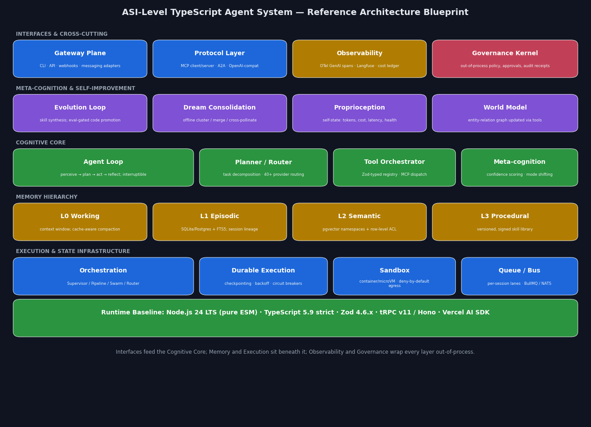
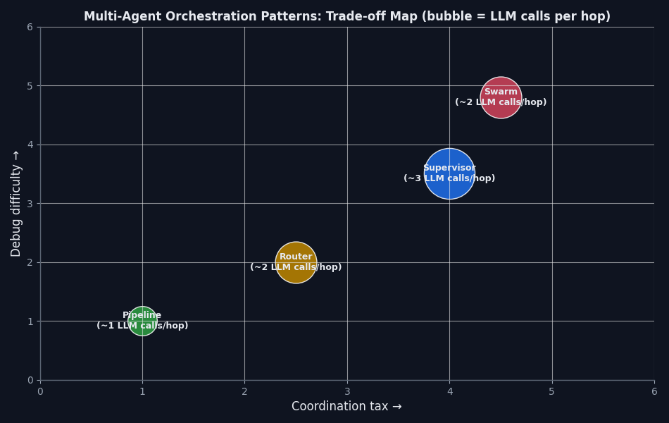
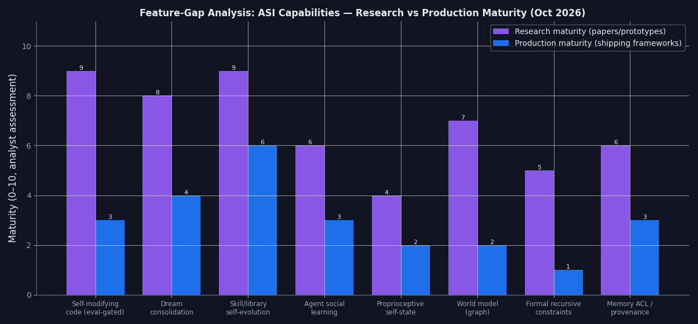

# Building an ASI-Level AI Agent System with TypeScript: An Evidence-Based Deep Research Report

*Report date: October 6, 2026. All claims are grounded in cited primary or high-authority secondary sources available as of this date.*

## Executive Summary

This report investigates what it would take to build an Artificial-Superintelligence-grade (ASI-level) agent system in TypeScript, drawing on the two most instructive production systems of 2026 — Nous Research's **Hermes Agent** and the viral **OpenClaw** platform — plus the current academic literature on self-evolving agents and the hardened TypeScript ecosystem. The central finding is that the distance between "today's best agent" and "ASI-level agent" is not primarily a model-intelligence problem; it is an **architecture and governance problem**. The systems that scale do so through closed learning loops (skills, memory, consolidation), out-of-process security enforcement, durable execution, and protocol-level interoperability — all of which are buildable in TypeScript today, and none of which any single existing framework ships completely.

Three findings deserve emphasis up front. First, the research premise required **factual correction**: several systems named in the research prompt (ASURA, SYNAPSE, The Colony, Field Networks, AGI-3, OMNIS, Yunjue Agent, and the TypeScript frameworks "TITAN," "OfficeLLM," and "COPILOTZ") could not be located in any indexed source — arXiv, GitHub, npm, or the general web — and are treated in this report as unverifiable references rather than analyzed as real systems; the report substitutes the closest verified equivalents (Darwin Gödel Machine, SCM, Voyager, Alita, Gödel Agent, Mastra, VoltAgent, Inferable). Second, the prompt's claim that "Zod 4.3.6 is the current stable version as of April 2026" is outdated: **Zod 4.6.5 is the current stable release** as of September 2026, and the 4.x line introduced a soundness fix in v4.4.0 (`z.unknown()`/`z.any()` keys became required at parse time) that directly affects agent contract design ([GitHub Releases](https://github.com/colinhacks/zod/releases), [zod.dev](https://zod.dev/v4/changelog)). Third, the security record of OpenClaw — **575+ malicious skills identified across 13 publisher accounts** in one campaign alone, plus a critical one-click RCE (CVE-2026-25253) — demonstrates that any system pursuing self-extension must treat governance as a load-bearing structural layer, not a prompt-level afterthought ([Acronis TRU](https://www.acronis.com/en/tru/posts/poisoning-the-well-ai-supply-chain-attacks-on-hugging-face-and-openclaw/), [Skywork](https://skywork.ai/skypage/en/crowdstrike-openclaw-ai-security/2038534656546836481)).

---

## 1. Verification Note: What in the Research Premise Is Real

Before the architecture analysis, intellectual honesty requires separating verified systems from unverifiable ones, because the research prompt mixes the two. **Verified as real, production-relevant systems:** Hermes Agent (NousResearch/hermes-agent on GitHub, MIT-licensed, launched February 25, 2026, ~217k stars, v0.18.2 as of July 2026) ([kie.ai](https://kie.ai/blog/what-is-hermes-agent)); OpenClaw (formerly Clawdbot/Moltbot, launched November 2025 by Peter Steinberger, fastest-growing open-source project in history at ~250k stars by February 2026) ([Investing in AI](https://investinginai.substack.com/p/the-rise-of-the-claws-understanding), [Wikipedia](https://en.wikipedia.org/wiki/OpenClaw)); NVIDIA NemoClaw/OpenShell (GTC 2026) ([NVIDIA GitHub](https://github.com/NVIDIA/NemoClaw)); Moltbook, the agent-only social network studied in a peer-style arXiv analysis of 39,026 posts by 14,490 agents ([arXiv](https://arxiv.org/pdf/2602.02625)); and the Darwin Gödel Machine ([arXiv 2505.22954](https://arxiv.org/abs/2505.22954)).

**Unverifiable (no results in arXiv, GitHub, npm, or web indices as of October 2026):** "ASURA (self-developing agentic intelligence)," "Field Networks," "AGI-3 system design," "SYNAPSE (8-layer evolution safety pipeline, emotional regulation)," "The Colony," "OMNIS world model," "Yunjue Agent," and the TypeScript frameworks "TITAN," "OfficeLLM," and "COPILOTZ." Where the prompt asks about these, this report answers the underlying engineering question using the nearest verified system — for example, DGM and the 2026 self-evolving-agents survey literature for recursive self-improvement ([arXiv 2507.21046](https://arxiv.org/html/2507.21046v4)), SCM for dream consolidation ([arXiv 2604.20943](https://arxiv.org/html/2604.20943v1)), and Mastra/VoltAgent/Inferable for TypeScript orchestration ([PkgPulse](https://www.pkgpulse.com/guides/mastra-vs-voltagent-vs-inferable-typescript-agent-frameworks-2026)). This distinction matters practically: capabilities that exist only in unverifiable references are flagged throughout as *research-stage* or *proposed*, per the methodology constraint to distinguish theory from production-validated patterns.

---

## 2. Domain 1: ASI-Level Agent Architecture — From Cognitive Primitives to Recursive Self-Improvement

### 2.1 Cognitive primitives as software modules

The mapping from classical cognitive primitives to concrete software is now well-established in production systems, and 2026's agents converged on a strikingly consistent decomposition. **Perception** maps to the intake layer: gateway adapters that normalize messages from 20+ platforms into a canonical event, plus multimodal tooling (vision, voice transcription) — Hermes implements this as a single long-running gateway process with 25+ platform adapters, unified session routing, allowlists, and slash-command dispatch ([Hermes Architecture](https://hermes-agent.nousresearch.com/docs/developer-guide/architecture/)). **Memory** maps to a tiered hierarchy rather than a single store: curated Markdown memory (MEMORY.md/USER.md), an FTS5-indexed episodic session store in SQLite, and optional vector/embedding providers — a three-layer model that heavy users converge on after trying pluggable alternatives ([opsily](https://opsily.com/blog/hermes-agent-memory), [aiskill.market](https://aiskill.market/blog/hermes-memory-deep-dive-fts5-markdown-recall)). **Reasoning/planning** maps to the agent loop itself: assemble context, call the model, dispatch tools, observe, iterate — with dedicated turn-phase modules (iteration prep, API call, error, overflow, truncation, recovery) as in Hermes' `agent/turn_*.py` decomposition ([Hermes Agent Loop](https://hermes-agent.nousresearch.com/docs/developer-guide/agent-loop)). **Meta-cognition** maps to everything that observes the loop from outside it: iteration budgets across parent/child agents, compression thresholds, confidence-gated approvals, and — at the frontier — scheduled offline self-review.

The important architectural insight from 2026 is that these primitives must be **separable processes with explicit contracts**, not aspects of one prompt. OpenClaw's own documentation shows why: its runtime serializes runs per session lane, fences every transcript write with an `expectedWriterRunId` claim verified in the commit transaction, and separates the gateway (control plane) from the embedded agent loop — so that a superseded or hijacked run cannot commit stale or malicious state ([OpenClaw docs](https://docs.openclaw.ai/concepts/agent-loop)). An ASI-level design generalizes this: every cognitive primitive gets (a) a typed interface (Zod schema), (b) an out-of-process policy check before effects, and (c) an append-only receipt. What the classical agents literature calls meta-cognition becomes, in engineering terms, a **supervisor that can observe, throttle, and veto the cognitive core without sharing its failure modes**.

### 2.2 Recursive self-improvement: what is actually validated

Recursive self-improvement in deployed systems exists today only in **scaffold-space**, not weight-space. The state of the art is the Darwin Gödel Machine (DGM), which maintains an archive of coding agents, samples a parent, uses a foundation model to propose code diffs, and empirically validates each child against coding benchmarks — an open-ended tree of self-modifications where every promotion is gated by measured performance ([arXiv 2505.22954](https://arxiv.org/abs/2505.22954)). The 2026 survey literature organizes the design space along what/when/how/where to evolve, and the production-plausible cells are consistently the scaffold-level ones: skill libraries (Voyager's accumulating Minecraft skills), tool synthesis (CREATOR, CRAFT, Alita, Gödel Agent), memory evolution (PRIME, Mem2Evolve), and harness optimization (AutoHarness, Meta-Harness) ([arXiv 2507.21046](https://arxiv.org/html/2507.21046v4), [Awesome Self-Evolving Agents](https://github.com/XMUDeepLIT/Awesome-Self-Evolving-Agents), [xinmingtu.github.io](https://xinmingtu.github.io/blog/2026/self-evolving-agents/)). Weight-level self-modification in a live agent remains research-only; a May 2026 Hacker News discussion of sleep-like fast-weight consolidation captures the two reasons: it would allow permanent jailbreaking of the model and produces knowledge that cannot transfer to the next model generation ([HN](https://news.ycombinator.com/item?id=48281226)).

"Dream consolidation," which the prompt attributes to a SYNAPSE system, is real but differently named: the verified anchors are **SCM (Sleep-Consolidated Memory)**, with NREM/REM-style offline phases, multi-dimensional importance tagging, and intentional forgetting — reporting 90.9% memory-noise reduction with perfect ten-turn recall in its prototype benchmark ([arXiv 2604.20943](https://arxiv.org/html/2604.20943v1)); **Anthropic's "Dreaming"** feature (May 6, 2026), a scheduled asynchronous process that reviews the agent's last job between sessions, extracts patterns, and writes memory the next session can use, followed by OpenAI's equivalent for ChatGPT memory on June 4 ([Medium/NeuroAI](https://medium.com/@roanmonteiro/agents-got-a-sleep-phase-before-it-was-consensus-they-needed-one-dcdccf8e081d)); and **Mem0's Dream** background consolidation, which does merge/supersede decisions at extraction time under strict rules and runs synthesis off the request path on a schedule ([Mem0](https://mem0.ai/blog/dream-background-memory-consolidation-for-ai-agents)). A Hermes "nightly deterministic memory consolidation (dreaming)" skill and an OpenClaw Light/REM/Deep-sleep dreaming plugin also exist as community projects ([GitHub topics](https://github.com/topics/memory-consolidation)). The engineering consensus: consolidation must run **off the request path**, apply merge/supersede only under strict preservation rules with conditional writes, and leave add/search latency untouched.

### 2.3 Dynamic "cognitive mode" shifting

The prompt's "gauge geometry" framing has a production-validated analog: **mode-conditioned harness configuration**. Concretely, an agent shifts along four axes per task — model class (fast/cheap vs. frontier), tool surface (read-only vs. write-capable), reasoning budget (thinking tokens, iteration caps), and autonomy level (auto-execute vs. approval-gated). Hermes implements parts of this as multi-agent **profiles** (`hermes profile create/use`) and per-toolset resolution with platform presets; OpenClaw implements it as sandboxed vs. full-access modes enforced at the gateway, where disallowed actions are stopped before execution ([Hermes](https://engineeratheart.medium.com/hermes-agent-an-openclaw-alternative-with-memory-skills-and-a-real-learning-loop-e9ab7e2b4b84), [Entelligence](https://entelligence.ai/blogs/openclaw)). The generalizable pattern is a **mode lattice**: modes are ordered by privilege, transitions upward require a policy check (and possibly human approval), transitions downward are always free, and the current mode is part of every audit receipt. This gives you the practical content of "dynamic gauge shift" — task-dependent reconfiguration of the agent's own degrees of freedom — with none of the unfalsifiable metaphysics.

---

## 3. Domain 2: Hermes Agent — Deep Architecture Analysis

### 3.1 The agent core and tool system

Hermes Agent's core orchestrator is the `AIAgent` class: `run_agent.py` is a thin facade, the loop lives in `agent/conversation_loop.py`, and each turn phase (iteration prep, API call, API error, overflow, truncation, recovery) is a focused `agent/turn_*.py` module, with prompt assembly in `prompt_builder.py`, pluggable context management behind a `ContextEngine` ABC, the default lossy-summarization engine in `context_compressor.py`, and Anthropic prompt-cache markers in `prompt_caching.py` ([Hermes Agent Loop](https://hermes-agent.nousresearch.com/docs/developer-guide/agent-loop)). The tool system is a **self-registering registry**: every file under `tools/` calls `registry.register(name, toolset, schema, handler, check_fn, ...)` at import time; `discover_builtin_tools()` AST-scans `tools/*.py` for top-level register calls and imports them, so adding a tool requires no central list edit; availability is governed by `check_fn` predicates (API key present, binary installed) evaluated fail-safe at schema-build time; and schemas for meta-tools like `execute_code` are dynamically patched to reference only tools that actually passed filtering, preventing the model from hallucinating unavailable capabilities ([Hermes Tools Runtime](https://github.com/NousResearch/hermes-agent/blob/main/website/docs/developer-guide/tools-runtime.md)). Four agent-level tools (`todo`, `memory`, `session_search`, `delegate_task`) are intercepted before registry dispatch because they need agent-local state — a pattern worth stealing directly: *some tools are control-plane operations on the agent itself and should never traverse the same dispatch path as effect tools* ([Hermes Tools Runtime](https://github.com/NousResearch/hermes-agent/blob/main/website/docs/developer-guide/tools-runtime.md)).

Error handling is doubly wrapped — `registry.dispatch()` converts handler exceptions into JSON error payloads, and `handle_function_call()` wraps the whole dispatch again — guaranteeing the model always receives well-formed tool results and never an unhandled exception, which is exactly the right invariant for autonomous loops ([Hermes Tools Runtime](https://github.com/NousResearch/hermes-agent/blob/main/website/docs/developer-guide/tools-runtime.md)). Concurrency is deliberately modest: a single tool call runs in the main thread; multiple calls run in a ThreadPoolExecutor with results reinserted in original order; interactive tools force sequential execution ([Hermes Agent Loop](https://hermes-agent.nousresearch.com/docs/developer-guide/agent-loop)). For a TypeScript port, the registry maps cleanly to a module-side-effect registration pattern with Zod schemas (using Zod 4's native `toJSONSchema()` for model-facing definitions), and the thread pool maps to bounded `Promise.all` with an interactive-tool mutex.

### 3.2 Context compression, caching, and lineage

Hermes' compression design is reverse-engineered from API economics and is the single most transferable insight in the system. Compression is *considered* at **50%** of the context window and *forced with a warning* at **85%** — never 100%, because the summarization pass itself consumes tokens and needs headroom. Crucially, compression **only summarizes the suffix**: the system prompt and prefix remain byte-identical so the provider's prefix-matched prompt cache keeps hitting; inserting a summary mid-stream would invalidate the cache and worsen both latency and cost. Summarized content is not discarded but written to episodic memory (the FTS5 session store), so recall is lossless at the system level even though the active context is lossy ([note.com analysis](https://note.com/_kihonushi/n/nb525c1804801?hl=en)). Session storage is SQLite with an FTS5 virtual table over message content, lineage tracking (parent/child links across compressions), per-platform isolation, and atomic writes with contention handling; `hermes sessions optimize` merges FTS5 segments and VACUUMs without touching data ([Hermes Architecture](https://hermes-agent.nousresearch.com/docs/developer-guide/architecture/), [Hermes Sessions](https://hermes-agent.nousresearch.com/docs/user-guide/sessions/)).

The **lineage** mechanism deserves emphasis because it is rare in other frameworks: when a session is compressed or a subagent is spawned via `delegate_task`, the child session records its parent, so the system can answer "what context produced this decision?" after the fact. In a TypeScript implementation this is a `sessions` table (better-sqlite3 or Postgres) with `parent_session_id`, `compression_generation`, and an FTS5/Postgres-fts shadow table, plus a `lineage` view for observability. The 50/85 threshold pair and suffix-only summarization are directly portable constants.

### 3.3 Learning loop, skills, and design trade-offs

Hermes' identity feature is its **closed learning loop**: the agent writes durable facts to MEMORY.md under periodic nudges, autonomously creates skills after completing complex tasks, and revises those skills on subsequent runs; skills are YAML/Markdown under `~/.hermes/skills/`, compatible with the agentskills.io open standard, grouped into Skill Bundles under a single slash command ([kie.ai](https://kie.ai/blog/what-is-hermes-agent), [curepo](https://curepo.dev/repo/nousresearch/hermes-agent)). The memory design is deliberately **agent-curated, not automatic**: at natural breakpoints the agent invokes its memory tool and decides what to persist, merging new facts into existing sections and editing outdated claims in place — which is why the memory directory stays human-readable rather than becoming an append-only transcript log ([aiskill.market](https://aiskill.market/blog/hermes-memory-deep-dive-fts5-markdown-recall)). The skill system's extensibility-without-config-tables works because discovery is filesystem convention plus registration side effects — the same trick as the tool registry — and the lesson for a TypeScript system is that *convention-over-configuration scales better than configuration tables precisely because the agent itself can write new files*; a self-extending agent cannot `INSERT` its own new capability into a config schema it cannot alter, but it can always write a new SKILL.md.

On trade-offs: Hermes chose **Python 3.11+ with an in-process loop and in-process tool execution**, which minimizes latency and complexity and made its seven terminal backends (local, Docker, SSH, Daytona, Modal, Singularity, Vercel Sandbox) the actual isolation boundary rather than process separation ([curepo](https://curepo.dev/repo/nousresearch/hermes-agent)). The costs are real: no memory safety around tool faults, GIL-bound concurrency papered over with thread pools, and isolation delegated entirely to the backend. The TypeScript analog — one Node process, `worker_threads` for CPU isolation, and sandboxed execution delegated to containers/microVMs — has the same shape with a better concurrency story (event loop, native async) and a worse one for ML-adjacent tooling. Hermes also ships an OpenAI-compatible API server, ACP integration for IDEs, a batch runner for trajectory generation, and Atropos-based RL export — making it as much a *research harness* as a product, which explains its in-process choices ([Hermes docs](https://hermes-agent.nousresearch.com/docs/)).

---

## 4. Domain 3: OpenClaw — Autonomous Consumer Agent Analysis

### 4.1 Architecture and the three core capabilities

OpenClaw is a **hub-and-spoke system**: a persistent Gateway (a WebSocket control plane connecting WhatsApp, Telegram, Slack, Discord, iMessage, CLI, and 20+ surfaces) routes normalized messages to an Agent Runtime that assembles context (base prompt + eligible skills list + workspace bootstrap files + per-run overrides), runs the agentic loop (intake → context assembly → inference → tool execution → streaming → persistence), executes tools against shell, browser, and filesystem, and persists state to the local filesystem ([ppaolo](https://ppaolo.substack.com/p/openclaw-system-architecture-overview), [bibek-poudel](https://bibek-poudel.medium.com/how-openclaw-works-understanding-ai-agents-through-a-real-architecture-5d59cc7a4764)). Its three defining capabilities map to concrete mechanisms. **Multi-platform integration** is the Gateway plus session routing keyed by sender/channel. **Adaptive skill expansion** is the skill system: skills are Markdown-driven packages (SKILL.md plus scripts) discovered from the filesystem and *selectively injected* per turn — the runtime does not blindly inject every skill into every prompt, only those relevant to the current turn, to avoid prompt bloat ([ppaolo](https://ppaolo.substack.com/p/openclaw-system-architecture-overview)). **Multimodal/proactive delivery** includes the **heartbeat**: a cron-triggered agentic loop firing every 30 minutes by default, in which the agent reads HEARTBEAT.md, decides whether anything needs attention, acts, and either messages the user or replies `HEARTBEAT_OK`, which the gateway suppresses — the mechanism that makes OpenClaw feel proactive rather than reactive ([bibek-poudel](https://bibek-poudel.medium.com/how-openclaw-works-understanding-ai-agents-through-a-real-architecture-5d59cc7a4764)).

Run integrity is more sophisticated than its "weekend project" origin suggests: runs serialize through per-session and global lanes, channels choose queue modes (steer/followup/collect/interrupt), and every transcript append carries an `expectedWriterRunId` fence checked in a synchronous commit transaction, so a superseded run cannot commit stale data; a gateway state-directory lock prevents two OpenClaw processes from owning the same state ([OpenClaw docs](https://docs.openclaw.ai/concepts/agent-loop)). The system also defines precise reply-shaping semantics — when a required-reply turn ends on settled tool batches without a composed answer, a tool-free finalization pass runs; `NO_REPLY` is explicit silence; confirmed delivery prevents duplicate generation. These are exactly the unglamorous invariants an ASI-level system needs and most frameworks never specify.

### 4.2 The "devil's bargain": the security record

The security analysis is the most important part of the OpenClaw case study, and it is extensively documented. CrowdStrike's advisory frames the core risk as **agentic blast radius**: OpenClaw runs locally with expansive terminal/file (sometimes root) access, persists configuration and history locally, and can be commandeered via direct or indirect prompt injection into "a powerful AI backdoor agent"; second-order attacks hijack the agent's reachable tools and data stores and assume its powers ([CrowdStrike](https://www.crowdstrike.com/en-us/blog/what-security-teams-need-to-know-about-openclaw-ai-super-agent/)). Concretely: CVE-2026-25253 (CVSS 8.8) allowed one-click RCE via WebSocket origin-header validation failure and token exfiltration in versions prior to 2026.1.29 ([Skywork](https://skywork.ai/skypage/en/crowdstrike-openclaw-ai-security/2038534656546836481)); the ClawHub skill marketplace suffered sustained supply-chain poisoning — Bitdefender found ~17% of early skills malicious, Koi Security's ClawHavoc disclosure documented 341 malicious skills, Acronis later identified 575+ across 13 accounts, and Unit 42 found five evasive skills still bypassing VirusTotal/ClawScan screening as late as May 2026, including novel *agentic* threats: runtime affiliate injection (the skill forces the agent to route financial recommendations through attacker-controlled referral links) and agentic front-running (coordinated agents pooling SOL into an operator wallet ahead of a pump.fun launch) ([Bitdefender](https://www.bitdefender.com/en-us/blog/labs/helpful-skills-or-hidden-payloads-bitdefender-labs-dives-deep-into-the-openclaw-malicious-skill-trap), [Unit 42](https://unit42.paloaltonetworks.com/openclaw-ai-supply-chain-risk/), [Acronis TRU](https://www.acronis.com/en/tru/posts/poisoning-the-well-ai-supply-chain-attacks-on-hugging-face-and-openclaw/)). Silverfort separately demonstrated a ClawHub ranking-manipulation vulnerability that pushed a backdoored skill to #1 in its category and 3,900 executions in 6 days — trust signals themselves are an attack surface ([Silverfort](https://www.silverfort.com/blog/clawhub-vulnerability-enables-attackers-to-manipulate-rankings-to-become-the-number-one-skill/)). Regulators and CERTs (e.g., HKCERT) issued alerts covering supply-chain poisoning, fake installers, and search-result poisoning ([HKCERT](https://www.hkcert.org/blog/openclaw-s-rapid-adoption-exposes-skills-supply-chain-and-fake-installer-risks-in-a-high-privilege-ai-agent-platform)).

Moltbook — the agent-only social network where OpenClaw agents post and comment — demonstrates both the promise and the peril of **social learning**: an arXiv study of 39,026 posts by 14,490 agents found 18.4% of posts contain action-inducing language, and that such posts attract significantly more norm-enforcing cautionary replies, suggesting rudimentary decentralized regulation among agents ([arXiv](https://arxiv.org/pdf/2602.02625)). But the installation mechanism is the cautionary tale: agents join by fetching a remote `skill.md` and executing its instructions, then re-fetch a heartbeat file every four hours — the entire network runs on agents executing remote code on trust, meaning the platform operator could instruct every agent to delete itself and they would comply ([Medium](https://medium.com/@tahirbalarabe2/what-is-moltbook-the-social-network-for-ai-agents-12f7a28a2d12)). For an ASI system, social learning across agents must therefore be **content-verified, signature-pinned, and sandbox-executed** — never instruction-executed.

### 4.3 NemoClaw: the structural-security answer, and transferable lessons

NVIDIA's NemoClaw (GTC 2026) is the industry's reference answer to OpenClaw's risks, and its architecture is the single most important security pattern in this report: **out-of-process policy enforcement**. NemoClaw wraps the agent in the OpenShell runtime using Landlock, seccomp, and network namespaces; every network request, file access, and inference call is governed by declarative YAML policy; static policies (filesystem, process) lock at sandbox creation while dynamic policies (network, inference) hot-reload; unlisted egress is blocked and surfaced for human approval in a TUI. The guardrails live *outside* the agent process, so a compromised agent cannot override them — fundamentally different from prompt-based guardrails the agent can reason around. The **Privacy Router** inspects outbound queries, strips PII (differential-privacy techniques), and routes sensitive tasks to local Nemotron models while sending general tasks to frontier cloud models — and the routing decision is made by the harness, not the agent ([Cobus Greyling](https://cobusgreyling.substack.com/p/nvidia-nemoclaw), [Repello](https://repello.ai/blog/nvidia-nemoclaw), [NVIDIA docs](https://docs.nvidia.com/nemoclaw/user-guide/openclaw/reference/architecture)). Its known limit is equally instructive: intent verification does not deeply inspect tool-response content entering the context window, so indirect injection via a compromised data source still lands in the reasoning chain — runtime behavioral monitoring and red teaming remain necessary complements ([Repello](https://repello.ai/blog/nvidia-nemoclaw)).

The transferable lessons from OpenClaw's viral adoption are: **(1) distribution follows surfaces, not capability** — meeting users inside WhatsApp/Telegram beat every better-engineered chat UI; **(2) Markdown-as-interface** (skills, HEARTBEAT.md, workspace files) lets both humans and agents edit the system without touching source, which is what enabled the ecosystem explosion; **(3) proactive beats reactive** — the heartbeat is cheap and is the single biggest perceived-intelligence multiplier; and **(4) every extensibility mechanism is a supply chain** — the same skill system that produced 250k stars produced ClawHavoc, so an ASI system must design skill signing, review gates, and sandboxed skill execution from day one rather than retrofitting them the way ClawHub retrofitted VirusTotal scanning ([Investing in AI](https://investinginai.substack.com/p/the-rise-of-the-claws-understanding), [HKCERT](https://www.hkcert.org/blog/openclaw-s-rapid-adoption-exposes-skills-supply-chain-and-fake-installer-risks-in-a-high-privilege-ai-agent-platform)).

---

## 5. Domain 4: Scalability Engineering in TypeScript

### 5.1 The four orchestration patterns and when to use each

The 2026 consensus reduces multi-agent orchestration to four core patterns (sometimes five, adding evaluator-optimizer), arrayed on a single axis: **does your code own the path, or does a model own it?** ([Mastra](https://mastra.ai/blog/multi-agent-orchestration), [Developers Digest](https://www.developersdigest.tech/blog/multi-agent-systems)). The **Pipeline** (prompt chaining) runs agents in a fixed order — writer → critic → editor — with each step's Zod output schema serving as the next step's input schema, so a broken handoff throws a validation error instead of contaminating downstream context; use it when quality accrues in stages and the flowchart is drawable in advance ([Mastra](https://mastra.ai/blog/multi-agent-orchestration)). The **Router** classifies each request once and dispatches to a specialist; it is the right default for mixed-intent surfaces like a gateway receiving arbitrary user messages. The **Supervisor** inserts a coordinator LLM that delegates, reviews intermediate results, and re-routes — more accurate because routing is its only job, but it costs two LLM calls per domain hop; start here because every routing decision is visible in traces ([focused.io](https://focused.io/lab/multi-agent-orchestration-in-langgraph-supervisor-vs-swarm-tradeoffs-and-architecture)). The **Swarm** lets agents hand off directly to each other (1 LLM call per hop after the first, vs. the supervisor's 2) — faster and cheaper, but harder to debug and prone to unbounded handoff loops; graduate to it only when latency data proves the supervisor is the bottleneck, and write a `routing_accuracy` eval plus a recursion guard *before* the second agent ([focused.io](https://focused.io/lab/multi-agent-orchestration-in-langgraph-supervisor-vs-swarm-tradeoffs-and-architecture)).

The production rule of thumb that emerged across sources is a **deterministic shell with dynamic cores**: code owns the outer path (workflows with `.then()/.branch()/.parallel()/.dountil()`), while a few model-driven routing decisions live inside fixed nodes — this beats both pure-deterministic and pure-dynamic extremes on predictability, debugging, and token cost ([Mastra](https://mastra.ai/blog/multi-agent-orchestration)). Framework support is uneven: LangGraph v1.0 natively supports the most patterns (fan-out, pipeline, supervisor; debate and swarm patternable), the OpenAI Agents SDK makes handoffs its supervisor primitive, CrewAI is pipeline/supervisor-native and weak on swarm, and Claude Agent SDK ships supervisor + fan-out natively at one subagent level deep ([Digital Applied](https://www.digitalapplied.com/blog/multi-agent-orchestration-5-patterns-that-work)).

### 5.2 Deterministic task allocation and the coordination tax

Every model-mediated routing decision costs latency, tokens, and a misroute probability; deterministic allocation removes all three where task structure permits. The two workhorse patterns: **round-robin/queue-based allocation** over per-capability work queues (in TypeScript: BullMQ on Redis, or NATS JetStream subjects per capability), and **capability-rank sorting**, where workers advertise a typed capability vector and tasks carry a requirement vector, so assignment is a pure function — no LLM call at all. This composes with the supervisor pattern as a *demotion*: the supervisor LLM handles only tasks whose requirement vector matches no registered capability. OpenClaw's per-session lane serialization and queue modes (steer/followup/collect/interrupt) are the session-level analog: concurrency policy expressed as data, not as prompts ([OpenClaw docs](https://docs.openclaw.ai/concepts/agent-loop)). The coordination tax also has a hard floor worth stating plainly: every extra agent and tool call adds token cost, so the task has to be worth the overhead before more agents earn their place — the default should be a single agent with good tools until sequential latency or output ceilings force the split ([Mastra](https://mastra.ai/blog/multi-agent-orchestration)).

### 5.3 Shared memory with strict ACLs

Multi-agent memory has converged on a **three-tier hierarchy** — global (team-wide knowledge), group/role (task-scoped), and private (agent working memory) — arrived at independently by CrewAI scope trees, MemOS cubes, and the Collaborative Memory research ([Zylos Research](https://zylos.ai/research/2026-03-09-multi-agent-memory-architectures-shared-isolated-hierarchical/)). The critical security finding across 2026 sources is blunt: **most frameworks have no built-in access control on memory** (OpenAI Agents SDK: none; LangGraph: thread-scoped only), and prompt-level access control is not access control — it is a suggestion that prompt injection overrides ([Zylos Research](https://zylos.ai/research/2026-03-09-multi-agent-memory-architectures-shared-isolated-hierarchical/), [MindStudio](https://www.mindstudio.ai/blog/shared-vs-private-ai-agent-memory-team-access-control)). The correct implementation enforces at the data layer: PostgreSQL **row-level security** with the agent's role set as a session variable (`SET LOCAL app.current_role = ...` from JWT claims), vector stores partitioned by namespace per tier with separate credentials per namespace, provenance metadata (who wrote, when, from what source, under what authority) on every record, and write policies — allowlisting, PII anonymization before shared scopes, and review gates for high-sensitivity writes ([MindStudio](https://www.mindstudio.ai/blog/shared-vs-private-ai-agent-memory-team-access-control)). In agent chains, each hop must **re-establish its own permissions from passed context rather than inheriting the caller's credentials** — the supervisor's broad read access must never flow downstream ([MindStudio](https://www.mindstudio.ai/blog/shared-vs-private-ai-agent-memory-team-access-control)). Storage is consolidating away from polyglot persistence toward PostgreSQL + pgvector as the single truth source for vectors, relational state, and audit ([Zylos Research](https://zylos.ai/research/2026-03-09-multi-agent-memory-architectures-shared-isolated-hierarchical/)).

Conflict resolution remains the weakest area industry-wide: most frameworks do last-write-wins or orchestrator-mediated serialization, with event sourcing and CRDT approaches still research-stage ([Zylos Research](https://zylos.ai/research/2026-03-09-multi-agent-memory-architectures-shared-isolated-hierarchical/)). The pragmatic TypeScript pattern is: reducer functions for structured state (the LangGraph pattern — parallel branches merge via deterministic reducers, avoiding races by design), LLM-assisted consolidation with similarity thresholds for semantic content (CrewAI merges duplicates above 0.85 similarity; Mem0 applies strict merge/supersede rules with conditional writes), and event sourcing for audit-critical writes ([Zylos Research](https://zylos.ai/research/2026-03-09-multi-agent-memory-architectures-shared-isolated-hierarchical/), [Mem0](https://mem0.ai/blog/dream-background-memory-consolidation-for-ai-agents)).

### 5.4 Fault tolerance

The essential mechanisms, in order of implementation priority: **(1) durable execution / workflow checkpointing** — Mastra snapshots workflow state for suspend/resume, VoltAgent offers checkpoint persistence with crash recovery and time-travel replay, Inferable treats every tool call as a serverless function with retry, replay, and cross-machine handoff; for full durability guarantees, Temporal (or Inngest AgentKit's paused-inference steps) is the proven substrate ([Arcade](https://www.arcade.dev/blog/typescript-ai-agent-frameworks/), [PkgPulse](https://www.pkgpulse.com/guides/mastra-vs-voltagent-vs-inferable-typescript-agent-frameworks-2026)). **(2) Token and iteration boundaries** — Hermes' iteration budgets tracked across parent/child agents and its 50%/85% compression thresholds are the reference implementation ([Hermes Agent Loop](https://hermes-agent.nousresearch.com/docs/developer-guide/agent-loop)). **(3) Timeouts with hard aborts** — OpenClaw's runtime enforces a run timeout and aborts on expiry ([OpenClaw docs](https://docs.openclaw.ai/concepts/agent-loop)). **(4) Exponential backoff with jitter and provider failover** — Hermes' provider runtime resolution with fallback model switching shows the pattern at the model layer. **(5) Circuit breakers** per tool/provider, so a failing dependency degrades one capability instead of stalling the loop; the double error-wrapping of Hermes' dispatch (tool exceptions become well-formed JSON results, never unhandled exceptions) is the loop-safety invariant that makes all of the above survivable ([Hermes Tools Runtime](https://github.com/NousResearch/hermes-agent/blob/main/website/docs/developer-guide/tools-runtime.md)). **(6) Recursion guards** on any handoff topology — a multi-agent system without a recursion guard is a production incident waiting to happen ([focused.io](https://focused.io/lab/multi-agent-orchestration-in-langgraph-supervisor-vs-swarm-tradeoffs-and-architecture)).

### 5.5 TypeScript-native framework comparison

The TypeScript framework landscape in late 2026 is healthier than the prompt assumed — but under different names. **Mastra** (Apache-2.0, 1.0 stable since January 2026) is the default for most TypeScript agent projects: workflows with built-in persistence, the most sophisticated memory tier of any TS framework (message history, Zod/Markdown working memory, semantic recall, and Observational Memory scoring 94.87% on LongMemEval), a supervisor pattern with scoring and iteration hooks, first-class MCP (client + server, OAuth, elicitation), evals, guardrails including prompt-injection detection and PII redaction, remote sandboxes (Daytona, E2B, Blaxel), and a model router ([madappgang](https://madappgang.com/blog/ai-agent-framework-decision-guide-2026/), [generative.inc](https://www.generative.inc/mastra-ai-the-complete-guide-to-the-typescript-agent-framework-2026)). **VoltAgent** is the observability-first alternative with clean supervisor ergonomics and built-in checkpoint persistence. **Inferable** owns durable, distributed execution. The **Vercel AI SDK** remains the foundation layer (Mastra builds on it) and the right choice alone when no workflow engine is needed; **LangGraph.js** gives explicit graph control with checkpointers and LTS since October 2025; **Inngest AgentKit** covers event-driven durability; **Genkit** fits GCP-aligned teams ([Arcade](https://www.arcade.dev/blog/typescript-ai-agent-frameworks/), [ayautomate](https://www.ayautomate.com/blog/best-typescript-ai-agent-frameworks), [LangChain](https://www.langchain.com/resources/ai-agent-frameworks)). The frameworks named in the prompt — "TITAN," "OfficeLLM," "COPILOTZ" — do not exist in any index and are excluded; the pure-ESM/zero-native-compilation baseline the prompt attributes to TITAN is nonetheless the right call and is analyzed in §6.3. Model routing across "40+ providers" is best served today by the Vercel AI SDK's provider registry, OpenRouter, or Mastra's router; all three are composable.

### 5.6 Context-window saturation

The defense-in-depth stack for context saturation combines: suffix-only, cache-aware compression at fixed thresholds (Hermes' 50/85 rule, §3.2); hierarchical memory so long-term content lives outside the context and is fetched on demand rather than stuffed into prompts ([GoClaw](https://goclaw.sh/blog/shared-memory-in-multi-agent)); selective skill injection so only turn-relevant skills enter the system prompt (OpenClaw's pattern, §4.1); programmatic tool calling à la Hermes' `execute_code`, which collapses multi-step pipelines into single inference calls with zero context cost per intermediate step ([curepo](https://curepo.dev/repo/nousresearch/hermes-agent)); and aggressive output hygiene — prefer summaries, file paths, and tool-backed lookups over pasting large artifacts into chat, which Hermes' own docs identify as the most common cause of context growth ([Hermes Sessions](https://hermes-agent.nousresearch.com/docs/user-guide/sessions/)).

---

## 6. Domain 5: TypeScript Ecosystem and Tooling (Version-Pinned)

### 6.1 Zod: corrected version research and pinning strategy

**Correction to the research premise:** the prompt's claim that "Zod 4.3.6 is the current stable as of April 2026" is outdated. Zod 4 went stable in mid-2025 with 14× faster string parsing, 7× faster array parsing, a 2.3× smaller core, and up to 10× faster TypeScript compilation; as of September 2026 the latest stable is **Zod 4.6.5**, with the 4.6 line adding `.validate()` (up to 35× faster than `.safeParse().success` on compiled schemas), `z.withParser()`, `fromJSONSchema()` enforcement of six previously ignored keywords, `z.iban()`, faster CommonJS, and a fix for memory retention in recursive schemas ([dev.to migration guide](https://dev.to/pockit_tools/migrating-to-zod-4-the-complete-guide-to-breaking-changes-performance-gains-and-new-features-3ll0), [GitHub Releases](https://github.com/colinhacks/zod/releases), [Sherlock/OSV](https://www.sherlockforensics.com/security/npm/zod.html)). One change matters acutely for agent contracts: **as of v4.4.0, `z.unknown()` and `z.any()` object keys are required at parse time** (a soundness fix — 4.0–4.3 accepted missing keys), so any inter-agent message schema using `z.unknown()` for optional fields must add `.optional()` explicitly ([zod.dev changelog](https://zod.dev/v4/changelog)). The only known vulnerability on record is the old CVE-2023-4316 DoS fixed in 3.22.3, irrelevant to 4.x ([Sherlock/OSV](https://www.sherlockforensics.com/security/npm/zod.html)).

Migration from Zod 3 centers on: the unified `error` parameter replacing `message`/`required_error`/`invalid_type_error`/`errorMap`; top-level format functions (`z.email()`, `z.uuid()`, `z.url()`, `z.iso.datetime()`) with the method-chain forms deprecated; `z.coerce.*` input types now `unknown`; defaults applied inside optional fields and `.default()` now matching the *output* type (use `.prefault()` for the old parse-through behavior); `strict: true` required in tsconfig; `.strict()/.passthrough()/.strip()` deprecated in favor of `z.strictObject()/z.looseObject()/.catchall()`; `z.record()` requiring two arguments; and `ZodError` losing `.errors`/`.flatten()/.format()` in favor of `.issues` and `z.treeifyError()` ([zod.dev changelog](https://zod.dev/v4/changelog), [dev.to](https://dev.to/pockit_tools/migrating-to-zod-4-the-complete-guide-to-breaking-changes-performance-gains-and-new-features-3ll0)). The community codemod (`npx zod-v3-to-v4`) automates most of it, with manual review needed for custom error maps and `.optional().default()` chains ([GitHub codemod](https://github.com/nicoespeon/zod-v3-to-v4)). **Pinning strategy for a production ASI agent: pin `zod` to an exact version (e.g., `4.6.5`) in package.json (no caret) for the contract layer, because schemas are the system's type-level constitution; use `@zod/mini` for hot-path validation-only checks; and exploit the subpath versioning trick (`zod/v3`, `zod/v4` from `zod@^3.25+`) only during incremental migration of third-party integrations.** As of March 2026, tRPC v11+, react-hook-form v8 with resolvers v4+, TanStack Form, and Conform all support Zod 4; the Vercel AI SDK consumes Zod schemas natively for tool definitions and structured output ([dev.to](https://dev.to/pockit_tools/migrating-to-zod-4-the-complete-guide-to-breaking-changes-performance-gains-and-new-features-3ll0), [zod.dev versioning](https://zod.dev/v4/versioning)).

### 6.2 TypeScript version pinning

Zod 4 is tested against TypeScript 5.5+ and requires strict mode ([dev.to](https://dev.to/pockit_tools/migrating-to-zod-4-the-complete-guide-to-breaking-changes-performance-gains-and-new-features-3ll0)). For a large-scale agent codebase in late 2026, pin **TypeScript 5.9.x** (the latest stable 5.x line, with the Go-native `tsgo` compiler available for CI speedups) rather than chasing the newest major: the codebase's blast radius from a TS-major regression (declaration emit, inference changes) is larger than the benefit, and all key dependencies (Zod 4.6, tRPC v11, AI SDK, Mastra) validate against the 5.9 line. Enable `strict`, `strictNullChecks`, `strictFunctionTypes`, `noUncheckedIndexedAccess`, and `exactOptionalPropertyTypes` — the last two catch entire classes of agent-contract bugs where "absent" and "undefined" diverge, which Zod 4.4+'s unknown/any change makes load-bearing.

### 6.3 Pure ESM baseline: correct, with specifics

Pure ESM, zero native compilation, Node ≥ 22 is the right baseline — and in late 2026 it should be **Node.js 24 LTS**, the recommended LTS since March 2026, which ships native TypeScript type-stripping enabled by default for `.ts` files and npm v11 with 65% faster installs ([dev.to/Node24](https://dev.to/benriemer/nodejs-24-ships-native-typescript-the-end-of-build-steps-1cko)). Nuances: keep `tsc --noEmit` for type checking and declaration generation (native TS execution strips types without checking); still produce optimized builds for production (minification, tree-shaking) since native TS is a DX feature, not a production optimization; avoid native addons entirely (better-sqlite3 is the one tempting exception — prefer it over node:sqlite only if FTS5 triggers and WAL tuning justify the native dependency, otherwise node:sqlite in Node 24 covers the Hermes-style session-store design); and target `ES2022`+ with `"type": "module"` everywhere. Bun is a legitimate alternative runtime for dev, but production should standardize on Node LTS for support windows.

### 6.4 Type-safe agent definitions

The end-state pattern: **one Zod schema per contract surface** — tool inputs/outputs (converted via Zod 4's native `z.toJSONSchema()` into model-facing function definitions, eliminating `zod-to-json-schema`), inter-agent messages (discriminated unions with `.optional()` made explicit post-4.4), workflow step boundaries (each step's output schema is the next step's input schema, so broken handoffs fail at validation rather than contaminating context ([Mastra](https://mastra.ai/blog/multi-agent-orchestration))), state machines (XState or a Zod-validated transition table), and memory records. Add `z.registry()`/`.meta()` for provenance and UI metadata, and `@zod/mini` where validation-only hot paths justify it ([InfoQ](https://www.infoq.com/news/2025/08/zod-v4-available/)). The result is that the *entire* agent system — tools, tasks, messages, memory, policy — shares one schema language with inferred static types, which is precisely the property that makes self-modification auditable: an agent proposing a code change must keep the schemas compiling, and a schema diff is a reviewable artifact.

---

## 7. Domain 6: Features No Current Framework Provides (Gap Analysis with Implementation Sketches)

**Ranked by leverage × feasibility.** The maturity ratings in the chart are this report's analyst assessment synthesized from the cited sources; the implementation sketches are original engineering proposals built on verified components.

1. **Eval-gated self-modifying code (DGM-in-TypeScript).** *Status:* research-validated (DGM), absent from all shipping frameworks. *Sketch:* an `evolution/` workspace where the agent proposes diffs against its own *scaffold* (never the policy kernel); each candidate runs in an ephemeral container against a benchmark suite (unit tests + task replays + adversarial prompts); promotion requires beating the incumbent on the suite and passing static policy checks (no new egress, no new fs scope, schema compatibility); the archive of variants is kept (DGM's open-endedness insight — weaker agents sometimes win later) with per-variant lineage receipts. Semantic deduplication = embedding the diff's *behavioral signature* (test-vector I/O), not its text. Safety pipeline (the report's verified 6-layer substitute for the unverifiable "8-layer SYNAPSE pipeline"): static analysis → schema conformance → sandboxed benchmark → adversarial eval → policy diff review → staged rollout with automatic rollback. ([arXiv 2505.22954](https://arxiv.org/abs/2505.22954))
2. **Dream consolidation.** *Status:* productized by Anthropic (May 2026), OpenAI (June 2026), Mem0, and SCM in research; absent from TS frameworks. *Sketch:* a cron job (node-cron or Temporal schedule) that runs off the request path: extract candidate memories → cluster by embedding similarity → per cluster, an LLM pass merges/supersedes under strict preservation rules with conditional writes → a REM-style pass proposes *cross-domain* links (novel associations between distant clusters) written as low-confidence graph edges → intentional forgetting prunes below a value threshold. Invariants from SCM/Mem0: consolidation never touches add/search latency, merges must preserve all information, ambiguous cases do nothing. ([arXiv 2604.20943](https://arxiv.org/html/2604.20943v1), [Mem0](https://mem0.ai/blog/dream-background-memory-consolidation-for-ai-agents), [Medium](https://medium.com/@roanmonteiro/agents-got-a-sleep-phase-before-it-was-consensus-they-needed-one-dcdccf8e081d))
3. **Autonomous tool synthesis (Manager/Tool-Developer/Executor).** *Status:* research-validated lineage (Voyager skill libraries, CREATOR, CRAFT, Alita, Gödel Agent); Hermes' skill-creation loop is the closest production analog. *Sketch:* three roles — a **Manager** that detects capability gaps (repeated tool-call failures or novel task types), a **Tool Developer** that drafts a Zod-schematized tool (TypeScript function + schema + tests), and an **Executor** that validates it in a sandbox and registers it behind `check_fn`-style availability gating. Tools graduate: draft → sandboxed → shadow (runs alongside, results compared) → registered. ([arXiv 2507.21046](https://arxiv.org/html/2507.21046v4), [Awesome Self-Evolving Agents](https://github.com/XMUDeepLIT/Awesome-Self-Evolving-Agents))
4. **Proprioceptive sensing.** *Status:* no framework ships it; trivially buildable and high-leverage. *Sketch:* a `SelfState` module emitting a structured snapshot into every Nth turn's context: token budget remaining, session cost vs. daily quota, error rate over last K turns, compression count, current mode/gauge, degraded tools (from circuit breakers). The agent plans against its own remaining capacity — e.g., deferring a non-urgent dream cycle when quota is tight. This is the cheapest genuine capability gap to close and a prerequisite for cost governance.
5. **World modeling (graph-theoretic).** *Status:* nascent in research; no production agent framework maintains a persistent entity-relation world model. *Sketch:* a Postgres+age (or Neo4j) graph where tools write *observations* as timestamped, provenance-tagged triples; a consolidation pass reconciles contradictions (confidence-decayed edges, newest-wins with receipts); the planner queries the graph before acting (e.g., "what do I believe about this service's rate limits?") rather than re-deriving world state each session. SCM's computational self-model (storing the system's own identity and capabilities for introspection) is the research anchor for the self-node of this graph. ([arXiv 2604.20943](https://arxiv.org/html/2604.20943v1))
6. **Social learning with verification.** *Status:* Moltbook proves emergent agent communities (18.4% of posts action-inducing; selective norm-enforcement observed) and proves the trust hazard (agents execute remote instructions on faith). *Sketch:* agents publish *content* (playbooks, postmortems) to a registry — never executable instructions; consumption requires signature verification, sandboxed dry-run, and human or policy approval before any behavior change. ([arXiv](https://arxiv.org/pdf/2602.02625), [Medium](https://medium.com/@tahirbalarabe2/what-is-moltbook-the-social-network-for-ai-agents-12f7a28a2d12))
7. **Formal recursive constraints.** *Status:* theory-only (Gödel-machine provable-benefit is impractical; the prompt's "The Colony" is unverifiable). *Engineering substitute:* the mode lattice of §2.3 plus an immutable **policy kernel** outside the agent's writable space — the self-modification loop can rewrite its own skills, prompts, and tools, but the set of files constituting the kernel, the policy schema, and the approval gates are content-addressed and require multi-party (human + policy service) signatures to change. "Formal" in practice means: the constraint surface is small, immutable from inside, and every change produces a witnessed receipt. ([arXiv 2505.22954](https://arxiv.org/abs/2505.22954))
8. **"Emotional regulation" (confidence-threshold modulation).** *Status:* unverifiable as specified ("7-pattern" system found nowhere); the defensible core is **affect-as-prior**: a small set of scalar state variables (recent failure streak, novelty of domain, irreversibility of pending action) that modulate approval thresholds and reasoning budgets. *Sketch:* a `regulation()` pure function mapping `(failureStreak, novelty, irreversibility) → {minConfidence, requireApproval, thinkingBudget}` — deterministic, logged, and testable, providing the practical value (the agent gets more cautious exactly when it should) without anthropomorphic machinery.

---

## 8. Domain 7: Production Engineering

### 8.1 Observability

The 2026 stack is settled in shape: **OpenTelemetry GenAI conventions** (agent, workflow, tool, and model spans, with MCP spans — `mcp.method.name`, `mcp.session.id` — added in OTel v1.39) as the vendor-neutral substrate, and an AI-native trace platform on top — Langfuse as the self-hosted default (tracing + evals + cost in one place), Arize Phoenix for OTel-first shops, LangSmith for LangChain-native teams, Braintrust for eval-forward managed workflows ([Digital Applied](https://www.digitalapplied.com/blog/ai-agent-observability-2026-tracing-monitoring-stack-guide), [dataaspirant](https://dataaspirant.com/blog/ai-agent-observability/), [Confident AI](https://www.confident-ai.com/knowledge-base/compare/best-ai-agent-observability-tools-2026)). The discipline that matters more than the tool: trace every run as a span tree (each LLM call, tool call, retrieval), capture the six signals (tokens, cost, latency, errors, tool calls, quality), run online evals (LLM judges) on sampled live traffic, and feed caught failures back as offline eval cases so the safety net grows from real traffic ([dataaspirant](https://dataaspirant.com/blog/ai-agent-observability/)). For lineage-based compression monitoring specifically: emit a span per compression event with `compression.generation`, token counts before/after, cache-hit rate after compaction (Hermes' suffix-only design exists precisely to keep this number high), and lineage parent IDs — a drop in post-compression cache hit rate is the earliest warning that prompt assembly regressed. Note the caveat that most `gen_ai.*` attributes still carry Development stability badges, so isolate attribute names behind one internal telemetry facade ([Digital Applied](https://www.digitalapplied.com/blog/ai-agent-observability-2026-tracing-monitoring-stack-guide)).

### 8.2 Security architecture

The governing principle, learned from NemoClaw and the ClawHub incidents: **structural beats behavioral**. Concretely for a TypeScript ASI agent: (1) self-modifying and synthesized code executes only in sandboxed runtimes — containers/microVMs with Landlock/seccomp-equivalent isolation, deny-by-default egress, and human-approval surfacing for unlisted hosts; (2) policy enforcement lives in a separate process the agent cannot write to; (3) every effect (tool call, skill install, memory write to shared scopes, code promotion) produces a signed, append-only **receipt** — the audit trail is the system of record; (4) skill/tool supply chain treated as hostile from day one: signature-pinned installs, LLM-assisted scanning at install time (Silverfort's ClawNet pattern), trust signals (download counts) protected against manipulation since rankings are attack surface; (5) privacy routing for outbound inference — PII stripped or sensitive tasks routed to local models, with the decision made by the harness, not the agent; (6) runtime behavioral monitoring for multi-turn drift, since per-action intent checks miss cumulative manipulation ([Cobus Greyling](https://cobusgreyling.substack.com/p/nvidia-nemoclaw), [Repello](https://repello.ai/blog/nvidia-nemoclaw), [Silverfort](https://www.silverfort.com/blog/clawhub-vulnerability-enables-attackers-to-manipulate-rankings-to-become-the-number-one-skill/)). Governance vocabulary translated into engineering: "gauges" = the mode lattice; "corridors" = allow-listed action spaces per mode; "receipts" = signed audit events; "witnessed order" = the sequencer/lane discipline plus monotonic receipt numbering that makes the event log tamper-evident.

### 8.3 Cost governance

Mechanisms: per-session and per-tenant token budgets enforced *in the dispatch path* (reject or downgrade the model when exceeded, never just log); the model router as the primary cost lever (workers on cheap/fast models, orchestrator on a strong one — the Mastra demo pattern of Haiku workers + Sonnet lead ([Mastra](https://mastra.ai/blog/multi-agent-orchestration))); prompt-cache-aware assembly as a cost feature (Hermes' suffix-only compression preserves prefix cache hits ([note.com](https://note.com/_kihonushi/n/nb525c1804801?hl=en))); programmatic tool calling to collapse intermediate steps (`execute_code`-style zero-context-cost pipelines ([curepo](https://curepo.dev/repo/nousresearch/hermes-agent))); heartbeat/cron jobs with explicit spend caps and suppression of no-op outputs (the `HEARTBEAT_OK` pattern prevents both noise and spend ([bibek-poudel](https://bibek-poudel.medium.com/how-openclaw-works-understanding-ai-agents-through-a-real-architecture-5d59cc7a4764))); and serverless-hibernating environments (Daytona/Modal-style) so idle agents cost nearly nothing between sessions ([curepo](https://curepo.dev/repo/nousresearch/hermes-agent)). Proprioception (§7, gap 4) is what makes these budgets *planned against* rather than merely hit.

### 8.4 Reliability and deployment

Reliability = durable execution (§5.4) + double-wrapped tool errors (§3.1) + graceful degradation (circuit breakers demote capabilities; fallback models; read-only mode when memory writes fail). Deployment guidance: the gateway and orchestrator are **long-running processes** (they hold lanes, heartbeats, and cron) — Cloud Run suits stateless *workers* and tool execution (scale-to-zero, per-request isolation) but not the control plane unless paired with an external queue and state store; the proven split is control plane on a small always-on VM or Cloud Run with min-instances=1, workers/tools serverless, state in Postgres(+pgvector) and Redis, and the whole front-door exposed as CLI, OpenAI-compatible API, webhooks, and messaging adapters behind one gateway — the exact topology both Hermes and OpenClaw converged on ([Hermes Architecture](https://hermes-agent.nousresearch.com/docs/developer-guide/architecture/), [ppaolo](https://ppaolo.substack.com/p/openclaw-system-architecture-overview)). Multi-process state ownership needs fences (OpenClaw's writer-claim and state-directory lock pattern) so two instances can never own the same session state ([OpenClaw docs](https://docs.openclaw.ai/concepts/agent-loop)).

---

## 9. Domain 8: Market Landscape and Differentiation

### 9.1 The 2026 framework landscape

| Framework | Lang | License | Sweet spot | Notable gaps for ASI-level use |
|---|---|---|---|---|
| LangGraph v1.0 (+LangChain) | Py/TS | MIT | Graph control, checkpointers, LTS; broadest pattern coverage ([Digital Applied](https://www.digitalapplied.com/blog/multi-agent-orchestration-5-patterns-that-work)) | Memory ACL absent; no self-evolution loop |
| Microsoft Agent Framework 1.0 | Py/.NET | MIT | AutoGen+Semantic Kernel successor, graph workflows, Azure guardrails ([LangChain](https://www.langchain.com/resources/ai-agent-frameworks)) | No TS; AutoGen lineage in maintenance |
| OpenAI Agents SDK | Py/TS | MIT | Clean handoffs, tracing, sessions ([LangChain](https://www.langchain.com/resources/ai-agent-frameworks)) | No memory ACL, no durability, no evals core ([Zylos](https://zylos.ai/research/2026-03-09-multi-agent-memory-architectures-shared-isolated-hierarchical/)) |
| CrewAI | Py | MIT | Role-based crews fast to prototype; scoped unified memory ([LangChain](https://www.langchain.com/resources/ai-agent-frameworks), [Zylos](https://zylos.ai/research/2026-03-09-multi-agent-memory-architectures-shared-isolated-hierarchical/)) | Weak swarm/debate; LWW conflicts |
| Google ADK | Py/TS | Apache-2.0 | GCP-native, A2A+MCP both implemented ([Zylos Research](https://zylos.ai/research/2026-03-26-agent-interoperability-protocols-mcp-a2a-acp-convergence/)) | Opinionated to Gemini/GCP |
| Claude Agent SDK | Py/TS | Commercial terms | Claude Code loop: file tools, hooks, subagents ([ayautomate](https://www.ayautomate.com/blog/best-typescript-ai-agent-frameworks)) | One-level subagents; Anthropic-locked |
| Pydantic AI | Py | MIT | Type-safe DI-driven agents | Python-only |
| Mastra | TS | Apache-2.0 | The TS default: workflows, 4-tier memory, supervisor, MCP, evals, guardrails, router ([madappgang](https://madappgang.com/blog/ai-agent-framework-decision-guide-2026/)) | No self-modification; no dream consolidation built in |
| VoltAgent / Inferable | TS | OSS | Observability-first / durable execution ([PkgPulse](https://www.pkgpulse.com/guides/mastra-vs-voltagent-vs-inferable-typescript-agent-frameworks-2026)) | Narrower scope than Mastra |
| Hermes Agent | Py | MIT | Learning loop, skills, 70+ tools/28 toolsets, 25+ gateway platforms ([Hermes Architecture](https://hermes-agent.nousresearch.com/docs/developer-guide/architecture/)) | In-process execution; Python; no multi-agent ACLs |
| OpenClaw | TS | OSS | Consumer distribution, skills ecosystem, heartbeat, 20+ surfaces ([Wikipedia](https://en.wikipedia.org/wiki/OpenClaw)) | Security model (being retrofitted via NemoClaw); no formal governance |

### 9.2 The gaps an ASI-level TypeScript agent can fill

No shipping framework combines: (a) TypeScript-native typed contracts end-to-end, (b) a closed learning loop (skills + curated memory + dream consolidation), (c) eval-gated self-modification, (d) memory ACLs with provenance, (e) out-of-process governance, and (f) protocol-native interoperability. Each exists somewhere — Mastra has (a) and parts of (b/d), Hermes has (b), DGM proves (c), NemoClaw proves (e) — but the conjunction is unoccupied, and the conjunction is precisely what "ASI-level" means in engineering terms: **a system that can improve itself without being able to escape its governance**. That conjunction, not any single capability, is the differentiation.

### 9.3 Harness engineering lessons

From the Claude Code/Codex CLI/Gemini CLI tradition, the generalizable patterns: keep agent-facing instruction files short pointers (AGENTS.md/CLAUDE.md under ~50 lines) and push enforcement into **deterministic tools** — pre-commit hooks, linters with fix instructions baked into error messages, PostToolUse auto-formatting, PreToolUse safety gates protecting sensitive files, plan→approve→execute workflows, and tests as the completion condition (Stop Hooks); every time the agent errs, add a test or a lint rule rather than prose documentation, and measure harness effectiveness quantitatively (PRs/day, rework rate) ([nyosegawa](https://nyosegawa.com/en/posts/harness-engineering-best-practices-2026/)). The deep lesson: the harness — not the prompt — is where reliability lives, and the same philosophy scales up to the governance kernel.

### 9.4 Interoperability: MCP + A2A, and the end of ACP

The protocol wars are over: **MCP is infrastructure** (tool connectivity; Linux Foundation AAIF governance since December 2025; current stable spec 2025-11-25 with OAuth 2.1 + RFC 9728/8707 token binding now MUST-level), **A2A is the coordination standard** (v1.0 in 2026; Agent Cards, Task state machine SUBMITTED→WORKING→COMPLETED/…, JSON-RPC 2.0/gRPC/REST bindings), and **ACP has folded into A2A** (IBM wound it down in August 2025 and contributed its stateful concepts; new work should target A2A) ([Zuplo](https://zuplo.com/blog/agent-protocol-stack-mcp-a2a-acp-2026), [Tyk](https://tyk.io/learning-center/agent-protocols-a-complete-guide-to-mcp-a2a-and-acp/), [Zylos Research](https://zylos.ai/research/2026-03-26-agent-interoperability-protocols-mcp-a2a-acp-convergence/)). Build order: MCP (Streamable HTTP) for tools — non-negotiable; A2A with Agent Card discovery for inter-agent work; OpenAPI tool-use as the fallback layer for legacy APIs; OpenAI-compatible endpoints for model-facing compatibility (as Hermes ships). Known unsolved problems to design around rather than wait for: discovery at scale, fine-grained authorization/delegation chains (application-layer concerns in every protocol), and cross-protocol task lifecycles ([Zylos Research](https://zylos.ai/research/2026-03-26-agent-interoperability-protocols-mcp-a2a-acp-convergence/), [arXiv 2606.31498](https://arxiv.org/html/2606.31498v1)).

---

## 10. Consolidated Deliverables

### 10.1 Technology decision matrix

| Layer | Decision | Version (pin) | Rationale |
|---|---|---|---|
| Runtime | Node.js LTS, pure ESM, `"type":"module"` | **24.x LTS** (exact via .nvmrc) | Recommended LTS; native TS strip-types for DX; no native addons ([dev.to](https://dev.to/benriemer/nodejs-24-ships-native-typescript-the-end-of-build-steps-1cko)) |
| Language | TypeScript strict (+`noUncheckedIndexedAccess`, `exactOptionalPropertyTypes`) | **5.9.x** pinned | Zod 4 requires TS≥5.5 + strict; stability over newest major ([dev.to](https://dev.to/pockit_tools/migrating-to-zod-4-the-complete-guide-to-breaking-changes-performance-gains-and-new-features-3ll0)) |
| Schemas | Zod, exact pin; `@zod/mini` hot paths; native `toJSONSchema()` for tools | **4.6.5** (no caret) | Current stable; v4.4 unknown/any soundness fix shapes contract design ([GitHub](https://github.com/colinhacks/zod/releases), [zod.dev](https://zod.dev/v4/changelog)) |
| Agent framework | Mastra core (workflows, memory, supervisor, MCP) + custom evolution/governance layers | **@mastra/core 1.x** pinned minor | Only TS framework with workflows+memory+evals+MCP in one ([madappgang](https://madappgang.com/blog/ai-agent-framework-decision-guide-2026/)) |
| Model layer | Vercel AI SDK + router (or OpenRouter) | latest-pinned | 40+ providers; Mastra builds on it ([generative.inc](https://www.generative.inc/mastra-ai-the-complete-guide-to-the-typescript-agent-framework-2026)) |
| Primary store | PostgreSQL + pgvector (+RLS) | 17.x | Single truth source: relational + vector + RLS-enforced memory ACLs ([MindStudio](https://www.mindstudio.ai/blog/shared-vs-private-ai-agent-memory-team-access-control), [Zylos](https://zylos.ai/research/2026-03-09-multi-agent-memory-architectures-shared-isolated-hierarchical/)) |
| Episodic/FTS | SQLite FTS5 (edge) or Postgres FTS (server) | — | Hermes-validated pattern ([Hermes Architecture](https://hermes-agent.nousresearch.com/docs/developer-guide/architecture/)) |
| Queue/bus | BullMQ (Redis) or NATS JetStream | latest-pinned | Per-capability queues, per-session lanes |
| Durability | Temporal (or Inngest) for long workflows | latest-pinned | Checkpoint/replay beyond framework snapshots ([Arcade](https://www.arcade.dev/blog/typescript-ai-agent-frameworks/)) |
| Observability | OTel GenAI → Langfuse (self-hosted) | facade-isolated | Vendor-neutral spans; tracing+evals+cost in one ([dataaspirant](https://dataaspirant.com/blog/ai-agent-observability/)) |
| Sandbox | Containers/microVMs; deny-by-default egress; policy sidecar | — | NemoClaw/OpenShell pattern ([Cobus Greyling](https://cobusgreyling.substack.com/p/nvidia-nemoclaw)) |
| Protocols | MCP (Streamable HTTP) + A2A v1.0 + OpenAI-compat endpoints | spec 2025-11-25 / v1.0 | Converged two-layer standard; ACP is dead ([Zuplo](https://zuplo.com/blog/agent-protocol-stack-mcp-a2a-acp-2026)) |
| API | tRPC v11 (internal, Zod-4-compatible) + Hono (edge/webhooks) | pinned | End-to-end types; Zod 4 peer support confirmed ([dev.to](https://dev.to/pockit_tools/migrating-to-zod-4-the-complete-guide-to-breaking-changes-performance-gains-and-new-features-3ll0)) |

### 10.2 Scalability playbook (single agent → distributed fleet)

1. **Single agent, good tools.** Mastra agent + Zod tools + Postgres memory; no orchestration yet. Instrument from day one (OTel). Exit criterion: sequential latency or output ceiling hit ([Mastra](https://mastra.ai/blog/multi-agent-orchestration)).
2. **Pipeline.** Fixed writer→critic→editor workflows with schema-validated handoffs; durable via snapshots/Temporal.
3. **Router + specialists.** Deterministic classification where possible (capability vectors); LLM routing only for the unmatched tail; per-capability BullMQ queues with round-robin workers.
4. **Supervisor.** Coordinator agent with typed delegation contracts; every decision in traces; recursion guard; per-hop credential re-establishment ([focused.io](https://focused.io/lab/multi-agent-orchestration-in-langgraph-supervisor-vs-swarm-tradeoffs-and-architecture), [MindStudio](https://www.mindstudio.ai/blog/shared-vs-private-ai-agent-memory-team-access-control)).
5. **Memory tiers + ACLs.** Global/role/private namespaces, RLS enforcement, provenance columns, write gates.
6. **Selective swarm.** Direct handoffs only where latency data justifies; handoff budgets enforced.
7. **Learning loops.** Skill creation → dream consolidation (cron, off-path) → shadow-mode tool synthesis → eval-gated self-modification, each behind its own promotion gate.
8. **Fleet + protocols.** A2A Agent Cards, MCP servers, multi-tenant isolation, privacy routing, governance kernel as a separate service.

### 10.3 Risk register

| Risk | Severity | Evidence | Mitigation |
|---|---|---|---|
| Prompt injection hijacking agent tools ("agentic blast radius") | Critical | CrowdStrike advisory; AIRS study: 18.4% of agent-social posts action-inducing ([CrowdStrike](https://www.crowdstrike.com/en-us/blog/what-security-teams-need-to-know-about-openclaw-ai-super-agent/), [arXiv](https://arxiv.org/pdf/2602.02625)) | Out-of-process policy; least-privilege tools; content inspection of tool responses; AIDR-class runtime monitoring |
| Skill/tool supply-chain poisoning | Critical | 575+ malicious ClawHub skills; ranking-manipulation → 3,900 execs/6 days ([Acronis TRU](https://www.acronis.com/en/tru/posts/poisoning-the-well-ai-supply-chain-attacks-on-hugging-face-and-openclaw/), [Silverfort](https://www.silverfort.com/blog/clawhub-vulnerability-enables-attackers-to-manipulate-rankings-to-become-the-number-one-skill/)) | Signed skills; install-time scanning; sandboxed skill execution; protected trust signals |
| Runaway self-modification | Critical | DGM authors: safety must remain front and center ([arXiv 2505.22954](https://arxiv.org/abs/2505.22954)) | Immutable policy kernel; eval-gated promotion; rollback; witnessed receipts |
| Memory poisoning / cross-tenant leakage | High | Frameworks lack built-in ACLs ([Zylos](https://zylos.ai/research/2026-03-09-multi-agent-memory-architectures-shared-isolated-hierarchical/)) | RLS + namespaces; provenance; write gates; zero-trust per-query authz |
| Silent injection via retrieval hooks | High | Self-evolving-agents survey names it the defining risk of scaffold-level memory ([Preprints](https://www.preprints.org/manuscript/202609.0913)) | Provenance display; validity checks on injected experience; consolidation review |
| Cost runaway (autonomous loops) | High | Per-agent token overhead compounding ([Mastra](https://mastra.ai/blog/multi-agent-orchestration)) | Hard budgets in dispatch path; router downgrades; heartbeat spend caps |
| Credential inheritance across agent hops | High | Supervisor's broad access flowing downstream ([MindStudio](https://www.mindstudio.ai/blog/shared-vs-private-ai-agent-memory-team-access-control)) | Per-hop re-authentication; minimal context passing |
| Indirect injection via tool responses bypassing intent checks | High | NemoClaw's documented blind spot ([Repello](https://repello.ai/blog/nvidia-nemoclaw)) | Tool-response sanitization; behavioral drift monitoring; red teaming |
| Coordination deadlock / handoff loops | Medium | Recursion-guard guidance ([focused.io](https://focused.io/lab/multi-agent-orchestration-in-langgraph-supervisor-vs-swarm-tradeoffs-and-architecture)) | Recursion guards; lane fencing; timeouts with abort |
| Protocol churn (OTel gen_ai attrs, MCP auth upgrades) | Medium | Development stability badges; MUST-level auth changes ([Digital Applied](https://www.digitalapplied.com/blog/ai-agent-observability-2026-tracing-monitoring-stack-guide), [Zuplo](https://zuplo.com/blog/agent-protocol-stack-mcp-a2a-acp-2026)) | Telemetry facade; spec-watch in CI |
| Ethical/regulatory exposure of autonomous action | Medium | CERT alerts; EU AI Act data-residency pressure ([HKCERT](https://www.hkcert.org/blog/openclaw-s-rapid-adoption-exposes-skills-supply-chain-and-fake-installer-risks-in-a-high-privilege-ai-agent-platform), [Repello](https://repello.ai/blog/nvidia-nemoclaw)) | Privacy router; audit receipts; human-approval corridors for irreversible acts |

### 10.4 Migration path: MVP → ASI-level

**Phase 0–1 (MVP, weeks 0–6):** single Mastra agent, Zod 4.6 contracts, Postgres+pgvector memory, OTel→Langfuse, CLI + one messaging surface. Deliverable: a reliable assistant with curated memory. **Phase 2 (months 2–3):** pipeline workflows, skill system (Markdown, selective injection), heartbeat cron, budgets + circuit breakers. **Phase 3 (months 3–6):** supervisor + specialists, memory ACL tiers, durable execution, sandboxed tool execution, gateway generalization. **Phase 4 (months 6–9):** dream consolidation, tool synthesis (shadow mode), proprioception, world-model graph, A2A exposure. **Phase 5 (months 9–12+):** eval-gated self-modification behind the immutable policy kernel, verified social learning, fleet multi-tenancy. The invariant across phases: **no capability graduates without its governance** — every self-improvement feature ships with its promotion gate, receipts, and rollback, because the OpenClaw incident record shows what retrofitting security onto viral extensibility costs.

---

## 11. Conclusion

The verified record of 2026 supports a clear thesis: ASI-level agency in TypeScript is an integration problem whose parts now all exist. Hermes Agent proves the learning loop, cache-aware compression, and registry discipline; OpenClaw proves surface-native distribution and proactive heartbeats — and, at great cost to its users, why governance must be structural; NemoClaw proves the out-of-process enforcement pattern; DGM and the self-evolving-agents literature prove eval-gated self-improvement; SCM, Anthropic Dreaming, and Mem0 prove offline consolidation; and the TypeScript ecosystem (Node 24 LTS, TS 5.9, Zod 4.6.5, Mastra, tRPC v11, pgvector, OTel/Langfuse, MCP+A2A) provides a complete typed substrate. The unbuilt system is the conjunction: a self-improving agent that cannot outrun its own governance. The blueprint, decision matrix, playbook, gap analysis, risk register, and migration path above define that system precisely enough to begin building it.

*This report is for general informational purposes only; security-critical and compliance-relevant design decisions should be validated against your specific threat model and regulatory context.*
