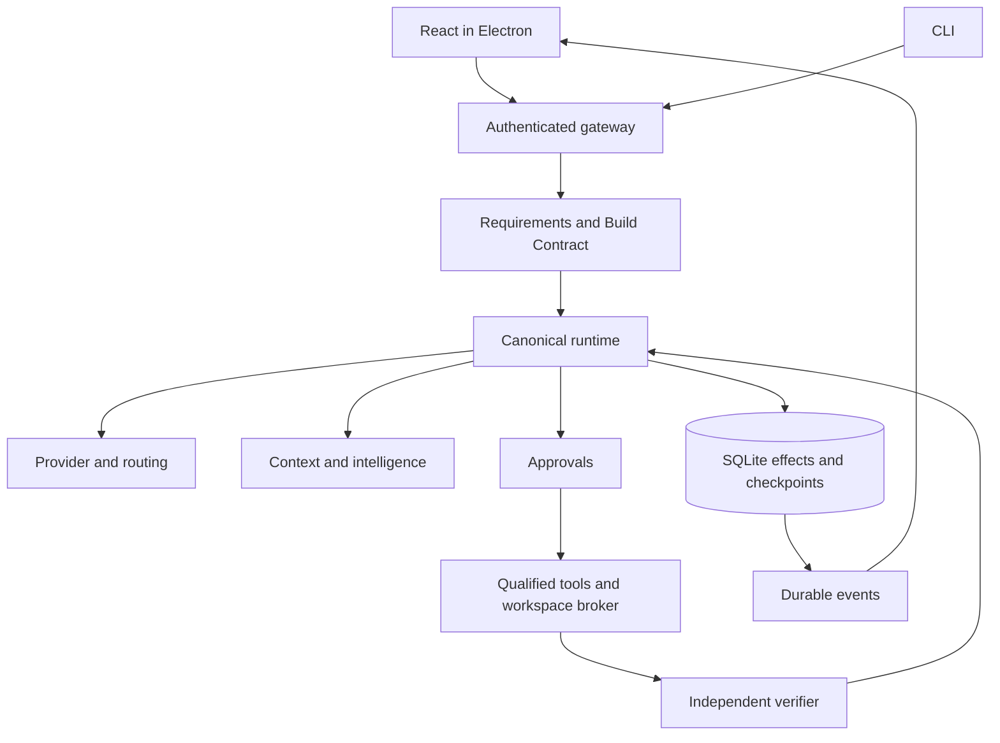

# System design

Sirona is a Windows-first local coding workspace. Electron main owns native boundaries; React owns presentation; Express authenticates and dispatches; domain services own decisions; SQLite owns durable state. LangGraph supplies bounded specialist work through the same canonical execution activities. No transport creates a separate agent runtime.

## State and trust

Principal/workspace/project/conversation/run/operation identities have distinct meanings. Models propose actions, policy grants authority, tools produce actual receipts, and a verifier establishes completion against fixed criteria. UI renders state and cannot grant itself privileges. Stable operation identities survive retries; uncertain external effects require reconciliation.

## Technology responsibilities

TypeScript/Node/Express own backend logic; Electron and safeStorage own native/credential boundaries. Vercel AI SDK remains behind provider adapters. LangGraph uses existing run ownership. Monaco, xterm.js and React Flow provide actual editor, terminal and monitoring surfaces. Zustand owns client state; TanStack Query owns server caching. Drizzle projection and Zod validation must match the reviewed SQLite schema. MCP SDK, Tree-sitter and ripgrep produce governed tool/context results.

Keep Redis, BullMQ and Mastra optional. A documented domain does not imply a microservice or new framework. See [data and recovery](data-and-recovery.md), [journeys](../journeys/index.md) and [approval gates](../governance/decisions.md).
