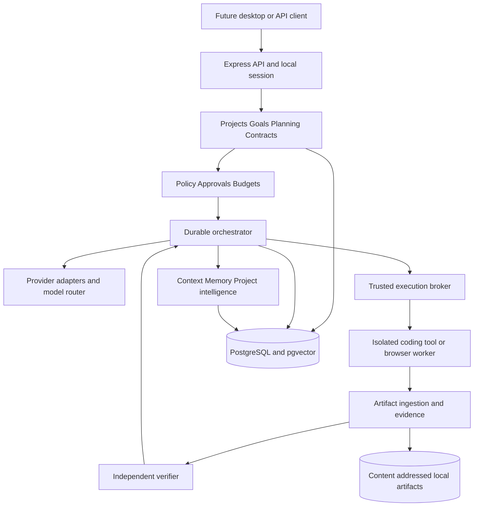
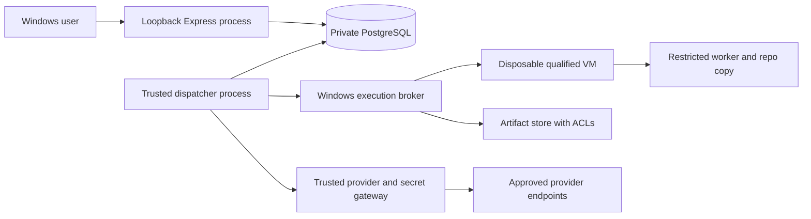
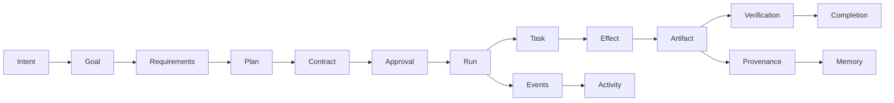
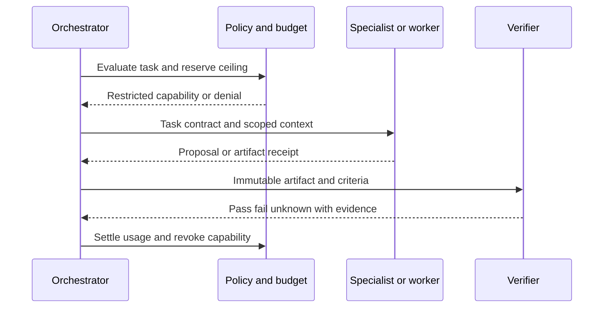
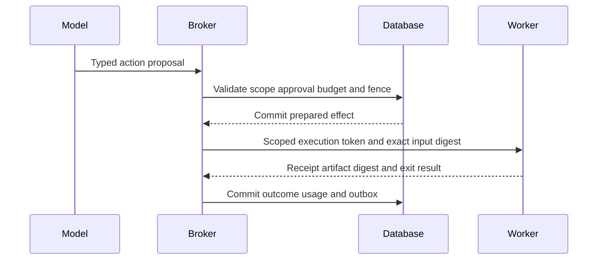
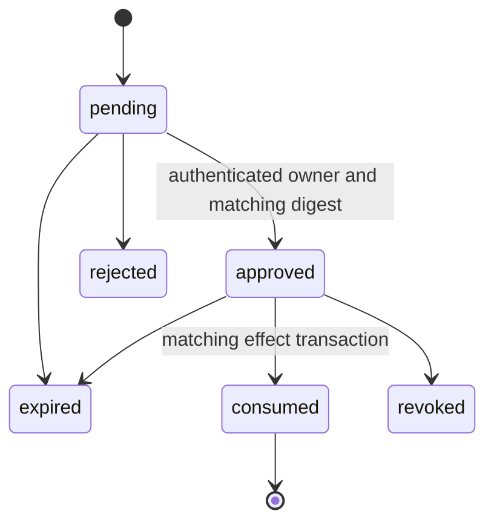
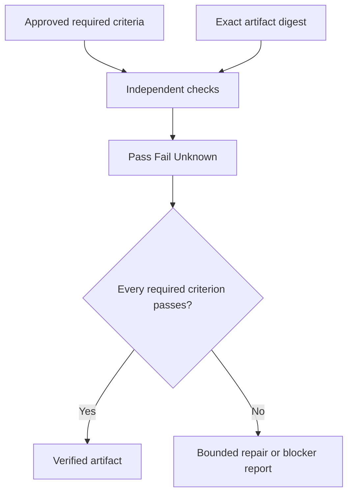
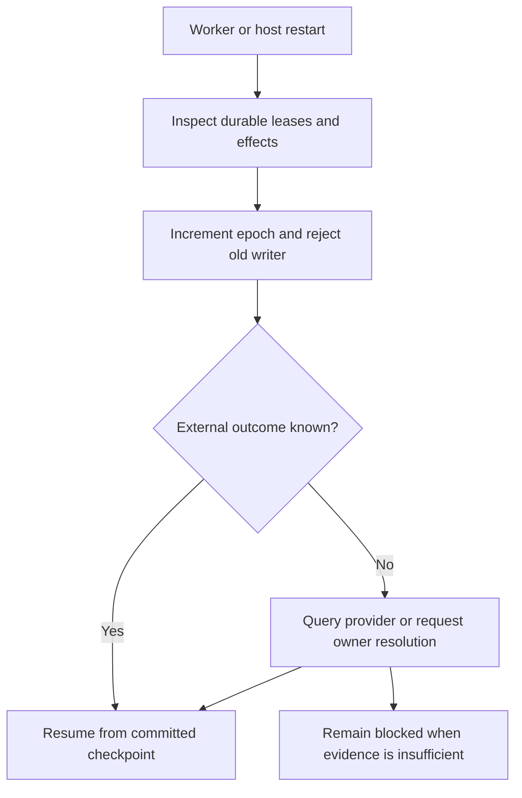

# ASI Master Architecture & Build Plan

Date: 2026-10-22. Status: proposed, build-ready specification subject to the explicit qualification gates below. Scope: backend, database, APIs, execution runtime, and implementation planning. Product authority: [unchanged product idea](../../PRODUCT_IDEA.md). Technical details in the linked companion documents are normative together with this master. A specification does not mark any capability implemented.

## Part 1 — Executive understanding

ASI is a governed digital creation and operations platform. Its intelligence layer converts intent into explicit requirements, an approved Build Contract, bounded execution, and independently verified artifacts. It maintains enough durable context to recover and continue. “ASI” is an aspirational product name, not a claim of artificial superintelligence.

A chatbot produces conversation; this product owns a goal lifecycle. A coding assistant helps a developer; this product also discovers requirements and defines evidence. A coding agent executes coding work; ASI can select and replace that worker. A workflow automation system follows predetermined flows; ASI may propose a new plan within a deterministic execution framework. A multi-agent framework hosts agents; ASI must additionally own authority, persistence, cost, recovery, and completion.

## Part 2 — Current repository reality

[Repository audit](02-REPOSITORY-REALITY.md) records evidence at commit `96f82dfc` and retained paths. Express middleware, contracts, SQL migrations, policy components, and test source exist. The inspected orchestrator uses a process-local Map. Windows executable isolation is explicitly unavailable. Default service model factories can use in-memory stores. These are substantial foundations but do not establish a working end-to-end autonomous product. Old UI/demo artifacts and previous Markdown/JSON files are removed. Backend source is retained, unqualified under the new design.

## Part 3 — Product and architectural principles

1. Preserve the original vision; bound each release explicitly.
2. Interpret intent before proposing implementation.
3. Ask only questions with material consequences.
4. Challenge costly or unsafe choices with evidence.
5. The orchestrator owns architecture; external coding agents execute tasks.
6. Prompts and agent transcripts are not authoritative workflow state.
7. Approval binds a concrete immutable revision and action digest.
8. Models cannot grant permissions or mark their own work verified.
9. Every side effect has identity, authorization, budget, and evidence.
10. Unknown external outcomes require reconciliation before retry.
11. Long work must survive process and machine restart.
12. Every scope boundary is enforced in trusted application code and data access.
13. Secrets stay outside prompts, embeddings, logs, and ordinary artifacts.
14. Structured relational memory comes before vector retrieval.
15. Use multiple agents only when measured benefit justifies their cost.
16. Quality includes user-goal completion and product usability.
17. Adapt providers and workers without changing domain authority.
18. Start with one control-plane deployment; separate execution for security.

## Part 4 — Killer workflow

The first supported outcome is a small application built in an isolated workspace from a reviewed specification. For an e-commerce request, discover catalog, buyer/admin flows, payment boundaries, operational needs, and constraints. Do not automatically add marketplaces, subscriptions, complex inventory, tax engines, or Kubernetes. Mark unchosen features as exclusions.

1. Capture intent and constraints in a conversation; create a goal.
2. Inspect the project or greenfield target; record source provenance.
3. Resolve material unknowns and research dependencies.
4. Produce requirements, acceptance criteria, architecture, and cost estimates.
5. Review the proposed solution; create an immutable contract revision.
6. Obtain owner approval for that revision and its permission/budget envelope.
7. Create a run pinned to contract, plan, repository base, and policy revision.
8. Dispatch bounded tasks to a qualified isolated worker.
9. Apply the patch in its workspace; run independently owned checks.
10. Repair within limits or stop with evidence and blockers.
11. Produce a product-quality review and requirement-level report.
12. Report verified artifact readiness. Production deployment requires a separate action approval, followed by deployment-specific health evidence.

“Production-ready” is conditional on named criteria and the verified target configuration. It is never inferred from generated files or a successful model response.

## Part 5 — Intelligence architecture

[Intelligence specification](06-INTELLIGENCE-AND-CONTRACTS.md) defines an Intent Engine, Requirements Engine, Research Engine, Planning Engine, Architecture Engine, Decision Engine, orchestrator, dynamic specialists, bounded debate, Model Router, and Context Engine. Engines are application services over typed inputs/outputs, not permanently running microservices. They emit proposals and evidence. Deterministic validators enforce schema completeness, consistency, scope, and legal transitions.

## Part 6 — Complete system architecture

### Logical architecture

### Runtime architecture

The API and dispatcher share one application release and domain library; they do not require independent network services per domain. The execution broker and guest have separate privilege boundaries. The model does not receive control-plane database credentials.

### Data flow

### Agent execution

### Tool execution

### Approval lifecycle

Contract approvals authorize repeated bounded tasks under one immutable contract; effect approvals authorize one specific high-impact effect. Only the latter are consumed once. Editing a contract creates a new revision and requires a new contract approval.

### Verification

### Recovery

## Part 7 — Domain boundaries

[Structure](03-BACKEND-STRUCTURE.md) specifies identity, projects, conversations, intelligence, planning, contracts, governance, orchestration, providers, tools, execution, memory, verification, automation, deployments, artifacts, and operations. Each owns writes to its tables. Shared transactions are coordinated explicitly by application services. Avoid a generic “services” bucket or shared mutable model registry spanning all domains.

## Part 8 — Provider and model system

[Provider specification](09-PROVIDERS-AND-MEMORY.md) separates direct inference, local endpoints, and coding-worker connections. A model registry contains versioned capabilities and qualification evidence, not assumed compatibility. Router hard filters privacy, modality, context, tool support, and budget before scoring quality, latency, and cost. Account availability is discovered through supported mechanisms only.

## Part 9 — Developer environment system

Adapters accept bounded execution contracts and return events, patches, receipts, and usage. Codex SDK/app-server and Claude Agent SDK are research-backed candidate interfaces; individual account entitlement and exact restrictions still require integration tests. Cursor, VS Code, Antigravity, Cline, and OpenCode remain optional adapter candidates until their required supported surface is verified. The backend never extracts browser session tokens or assumes a subscription is a generic inference API.

## Part 10 — Tool and sandbox runtime

[Security specification](08-SECURITY-AND-RUNTIME.md) defines capability manifests, typed validation, risk classification, timeouts, idempotency, audit, cancellation, output quarantine, Windows ACLs, and VM isolation. Generated code cannot execute on the host because a model or plugin requests it. A restricted process is not by itself a sufficient hostile-code boundary.

## Part 11 — Browser and computer runtime

Use per-run browser contexts in isolated guests for test automation. Keep authenticated browsing distinct from public research and anonymous QA. Session state is a secret; screenshots may be sensitive. Browser text is evidence, not authority. Unknown submit outcomes enter reconciliation. General desktop control is later and remains disabled until action capture, permissions, cancellation, and isolation are demonstrated.

## Part 12 — Memory and project intelligence

Relational records represent user/project/task/episodic/semantic/decision/failure/evaluation memory. pgvector supplements exact lookup and full-text retrieval. Source revisions, access rules, correction, expiry, and deletion apply before retrieval and reranking. A relational knowledge graph plus AST-derived symbols and dependency edges supports project intelligence; a dedicated graph database is unnecessary initially.

## Part 13 — Durable orchestration

[Execution specification](07-ORCHESTRATION-AND-RECOVERY.md) chooses a narrow PostgreSQL state machine with leased tasks, checkpoints, transactional outbox, and effect journal for local v1. It is not a general workflow language. Temporal is the preferred reassessment candidate if distributed workflow complexity outgrows this bounded system. The cost of maintaining custom recovery is an explicit release risk, not hidden simplification.

## Part 14 — Agent architecture

Start with one planning role, one execution worker, and one independently controlled verification path. Spawn specialist sessions only for a measurable task. Give each a scoped context, deadline, tool set, token budget, and deliverable schema. Default planning ceiling: three parallel specialists, two critique rounds, one level of delegation. Treat these as initial tuning values. Agent identities cannot impersonate the human approver.

## Part 15 — Verification engine

[Verification specification](10-VERIFICATION-AND-OPERATIONS.md) maps requirements to required checks and evidence pinned to the artifact digest. Passing producer-supplied tests alone is insufficient. The implementation worker cannot edit acceptance criteria, approved test baselines, or verifier policy. Unknown checks prevent required completion. Changed artifacts invalidate previous results.

## Part 16 — Scheduling and events

Persist timezone-aware recurrence, next occurrence, overlap policy, catch-up policy, budgets, and run history. Validate signed inbound events and deduplicate source delivery IDs. A trigger creates a goal or run under its own approved policy envelope; events cannot manufacture approval. Schedules survive downtime and explain skipped/missed occurrences.

## Part 17 — Deployment architecture

Deploy the backend locally under the user's Windows account with loopback access and private database/artifact storage. A later service installation must be qualified under its actual Windows identity. Generated applications deploy through adapters using immutable build artifacts, target preflight, migration plans, explicit approval, health checks, and rollback eligibility. AWS/Azure/GCP/Vercel/Cloudflare/Railway/Render are future targets, not implemented integrations.

## Part 18 — Security architecture

Threats include prompt injection, malicious repositories, compromised dependencies, agent impersonation, approval replay, path escape, credential leakage, SSRF, browser sessions, and unsafe tools. Enforcement belongs to typed APIs, policy evaluation, database scope, broker capabilities, guest isolation, and secret resolution. Models may explain a denial but cannot override it.

## Part 19 — PostgreSQL and data architecture

[Database specification](04-DATABASE.md) defines schema ownership, full entity dictionary, scoped foreign keys, immutable revisions, hot-path indexes, transaction recipes, RLS, retention, migrations, and restore. PostgreSQL owns workflow truth. The artifact filesystem owns large bytes. pgvector owns semantic indexes. Redis is not required for the first release. Existing SQLite episodes need an explicit resumable import, not an assumption that PostgreSQL migrations cover them.

## Part 20 — API architecture

[API specification](05-API-CONTRACTS.md) uses `/api/v1`, REST for resources/commands, SSE for durable progress, and authenticated internal worker messages for execution. Public APIs never expose arbitrary SQL, terminal execution, or provider credential retrieval. WebSockets are deferred until bidirectional interaction has a proven need. JSON transport remains valid despite removal of repository JSON files.

## Part 21 — Future client product architecture

Frontend implementation is explicitly removed from this task. Backend projections support a later hierarchy: Chat/Intent → Plan → Build Contract → Execution → Approvals → Artifacts → Verification, with Models, Developer Environments, Tools, Memory, Activity, Automations, and Settings as supporting surfaces. Every approval projection includes exact scope, target, cost ceiling, diff, expiry, and consequences. Every completion projection includes evidence and known limits. These are API requirements, not a new frontend build plan.

## Part 22 — Observability and cost

Correlate principal, conversation, goal, plan revision, contract revision, run, task, agent, model call, tool effect, artifact, and verification. Store safe structured events and usage ledgers; export OpenTelemetry traces. Atomically reserve funds before dispatch across project/run scopes. Track estimates separately from reconciled provider usage; unknown charges remain reserved. Offline work cannot accumulate unbounded external spend.

## Part 23 — Evaluation framework

Measure understanding, requirement omission, architecture constraint satisfaction, task completion, repair effectiveness, tool safety, retrieval relevance, cost, and restart reliability using frozen suites. Compare prompt/router revisions against the same fixtures and artifact-level checks. Separate deterministic correctness from rubric judgment and repeated statistical evaluation. New policies require offline results and a reviewed rollout; the system does not self-modify governance in production.

## Part 24 — Failure and recovery model

Classify validation, authorization, provider throttling, transient transport, unknown side effects, worker crash, sandbox failure, budget exhaustion, stale approval, verification failure, data corruption, and user cancellation. Each has its own bounded retry or stop rule in [durable execution](07-ORCHESTRATION-AND-RECOVERY.md). No generic retry-all wrapper surrounds external mutations.

## Part 25 — Technology decisions

[Decision records](12-DECISIONS-AND-RESEARCH.md) give rationale, alternatives, dependencies, risks, order, and acceptance for each major selection. Node.js/Express/PostgreSQL/pgvector are fixed user requirements. SQL-first access, JavaScript ES modules, Zod validation, local artifact storage, PostgreSQL scheduling, provider adapters, and Windows guest isolation are selected implementation directions. Exact package versions are qualified and pinned during foundation work, not guessed from old manifests.

## Part 26 — Target repository structure

[Folder specification](03-BACKEND-STRUCTURE.md) defines `backend/src`, `backend/database`, `backend/tests`, platform adapters, and domain modules. It is a proposed tree; no empty implementation folders or placeholder runtime code are generated here. Retained legacy files are inputs to migration, not a second supported target structure.

## Part 27 — Migration strategy

Restore a minimal backend build, establish source tests, then move working behavior one domain at a time behind stable ports. Replace map-backed production state and legacy approval modes. Reuse SQL, policy, privacy, and budget concepts only after invariant tests pass. Do not run the old ledger-dependent migration script after deleting its JSON inputs. Keep baseline history available for recovery and compare before replacing working logic.

## Part 28 — Exact implementation sequence

[Implementation task cards](11-IMPLEMENTATION-ROADMAP.md) specify objectives, dependencies, backend/database/API work, tests, security, exit criteria, exclusions, and future-client consequences for every stage. Gates are conjunctive: no execution stage bypasses session, approval, budget, artifact, or sandbox prerequisites.

## Part 29 — MVP, V1, V2, and long-term vision

| Release | Outcome | Deliberate limits |
| --- | --- | --- |
| MVP | One small application from idea to approved plan to verified artifact, with restart recovery | One provider, one coding adapter, one isolated environment, one owner; deployment may remain manual |
| V1 | Reliable autonomous development for new and existing repositories | Qualified memory, multiple providers, schedules, tested deployment adapter, operational recovery |
| V2 | Broader digital work and event-driven operation | Browser workflows, more integrations, remote workers after isolation/identity qualification |
| Long term | General digital creation and recurring operation | Collaboration/cloud/accounts/billing only after product need; every new domain retains governed execution |

Mobile applications, infrastructure changes, financial workflows, and email automation remain part of the vision but each needs its own adapters and verifiers before becoming supported.

## Part 30 — Top 20 technical risks

| Rank | Risk | Probability / impact | Mitigation | Detection |
| --- | --- | --- | --- | --- |
| 1 | Unsafe generated code escapes isolation | Medium / critical | Qualified VM, no host secrets or mounts | Adversarial escape and egress suite |
| 2 | Duplicate external action after crash | High / critical | Effect journal, reconciliation, stable idempotency | Crash at every dispatch boundary |
| 3 | Approval authorizes changed work | Medium / critical | Canonical digest and immutable revision | Replay and mismatch tests |
| 4 | False completion | High / high | Independent criteria and artifact-bound evidence | Hidden regression fixtures |
| 5 | Custom orchestration loses state | Medium / high | Transactions, fenced leases, fault injection | Restart and stale-writer tests |
| 6 | Secret enters context or artifact | Medium / critical | Secret broker, output scanning, redaction | Canary credential leakage tests |
| 7 | Prompt injection controls tools | High / high | Untrusted labels and deterministic policy | Poisoned docs/repository/browser suite |
| 8 | Cost exceeds limits concurrently | Medium / high | Atomic reservations and concurrency ceilings | Parallel budget race tests |
| 9 | Legacy maps mistaken for persistence | High / high | Production composition rejects volatile stores | Process restart tests |
| 10 | Provider/IDE integration unsupported | High / medium | Supported surfaces and capability qualification | Adapter conformance evidence |
| 11 | Windows prerequisites unavailable | Medium / high | Capability preflight and plan-only fallback | Fresh machine install matrix |
| 12 | Vector search crosses scope | Medium / critical | Scoped SQL, RLS, no shared unsafe caches | Cross-project retrieval tests |
| 13 | Low vector recall under filters | Medium / medium | Exact baseline and tuned ANN | Recall benchmark per filter selectivity |
| 14 | Repair weakens tests | High / high | Protected criteria and independent tests | Test-diff review and mutation testing |
| 15 | Stale project intelligence | High / medium | Commit and content hashes | Changed-symbol invalidation tests |
| 16 | Migration corrupts legacy data | Medium / high | Copy/import checksums, restore rehearsal | Counts, invariants, rollback rehearsal |
| 17 | Dependency supply-chain compromise | Medium / high | Pinned reviewed dependencies, isolated builds | SBOM and installation review |
| 18 | Event/schedule duplication | Medium / high | Unique occurrence/delivery identity | Restart, overlap, DST tests |
| 19 | Artifact or audit storage fills disk | Medium / high | Quotas, retention, fail closed | Disk-pressure and backlog alerts |
| 20 | Scope expands faster than validation | High / high | Release gates and explicit exclusions | Acceptance coverage and milestone review |

Probability values are engineering estimates for planning, not measured incident frequencies.

## Part 31 — Product-owner decisions

Only these decisions remain genuinely product-specific: the first representative application and required deployment target; acceptable monthly/per-run spend ceilings; whether external inference may receive private source code; which Windows editions/hardware must be supported; and how long project content/evidence should be retained. Defaults for planning: one local owner, no production deployment without separate approval, no paid service creation, configurable privacy, and budgets supplied before real provider execution. Missing values block the affected execution, not specification work.

## Part 32 — Final recommended build roadmap

01 Baseline/package restoration → 02 PostgreSQL foundation → 03 Local identity → 04 Projects/artifacts → 05 Policy/approvals/budgets → 06 Provider interface and one real provider → 07 Durable tasks/effects → 08 Intent/research/requirements → 09 Plans/contracts → 10 Windows sandbox qualification → 11 Tool broker/coding adapter → 12 Independent verification → 13 Killer workflow and bounded repair → 14 Memory/project intelligence → 15 Schedules/events → 16 Browser/deployment adapters → 17 Windows release qualification → 18 Additional providers and remote/cloud evolution.

Follow the exit criteria in the task cards. Passing a documentation review is not permission to skip the executable tests.
