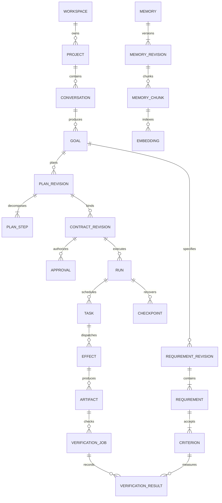

# PostgreSQL and pgvector database specification

Status: proposed schema contract, not applied migrations. Target: one PostgreSQL database for one local installation. Select a supported PostgreSQL major with a qualified Windows pgvector build; retain compatibility with the existing PostgreSQL 17 baseline unless an upgrade is explicitly tested. Do not choose a preview server version for production.

## Ownership and universal rules

Use logical schemas `identity`, `product`, `planning`, `control`, `inference`, `knowledge`, `verification`, `automation`, and `ops`; they are ownership namespaces within one database, not separate servers. Use `snake_case` SQL names and `camelCase` public JSON names. Every mutable aggregate has `version bigint` starting at 1, `created_at timestamptz`, and `updated_at timestamptz`. Every scoped record has `workspace_id uuid NOT NULL`. Project-owned records also carry `project_id uuid NOT NULL`. Global provider metadata is deliberately installation-scoped and cannot contain private content.

Scope exceptions are explicit: principals are installation identities; workspaces are the scope root and do not reference themselves; the migration journal and immutable public tool/model capability templates are installation-wide. Connections containing private configuration remain workspace-owned. Memory with user/workspace scope may have null project_id; project/task memory requires project_id and a scope consistency CHECK. No other nullable scope is accepted implicitly.

Generate UUIDs in trusted application code. Store times in UTC `timestamptz`; store IANA timezone separately for recurrence. Use `bigint` micro-USD or original-currency minor units for money, never floating point; serialize 64-bit values as decimal strings in JSON. Store SHA-256 as `bytea` constrained to 32 bytes; expose lowercase hex externally. Use `jsonb` for versioned documents, capability descriptions, and bounded metadata, not for relational foreign keys or the entire database.

Each scoped parent has `UNIQUE(workspace_id,id)`, and each project-owned parent additionally has `UNIQUE(workspace_id,project_id,id)`. All child references use the corresponding composite foreign key. This prevents a valid ID from another project being joined into an unauthorized run. Opaque UUIDs are identifiers, not authorization.

Default FK delete behavior is RESTRICT. Cascades are permitted only for non-evidentiary children under an explicitly authorized purge workflow. No deletion of a project silently cascades through approvals, usage, or evidence while retention obligations remain. Soft deletion is used for user-visible lifecycle, followed by explicit retention/purge.

## Entity dictionary

Notation: `!` required, `?` nullable; `ref` is a scoped foreign key; all tables have an `id uuid` except composite-key join tables and explicitly sequenced tables. Fields below supplement the universal scope/timestamp/version rules. Immutable rows have only `created_at`; updates are rejected by privileges/triggers or by the owning append-only port.

### Identity and product

| Table | Required domain fields and key constraints | Purpose / lifecycle |
| --- | --- | --- |
| `identity.principals` | `kind! local_user/worker`, `display_name!`, `disabled_at?`, `credential_binding?` | One human local principal initially; workers get distinct identities |
| `identity.workspaces` | `owner_principal_id!`, `name!`, `status!` | Local ownership seam; no organization/RBAC product yet |
| `identity.sessions` | `principal_id!`, `token_hash! UNIQUE`, `csrf_hash!`, `expires_at!`, `revoked_at?` | Persist only token hashes; expiry/revocation checked every request |
| `identity.worker_connections` | `worker_principal_id!`, `public_key!`, `capabilities! jsonb`, `image_digest?`, `last_seen_at?`, `revoked_at?` | Authenticated worker handshake; never trusts browser identity headers |
| `identity.secret_references` | `owner_principal_id!`, `store!`, `opaque_ref!`, `purpose!`, `credential_version!`, `revoked_at?` | Reference metadata only; no credential ciphertext/plaintext in ordinary tables |
| `product.projects` | `name!`, `kind! greenfield/existing`, `workspace_root_ref?`, `repository_url?`, `status!` | Validated host path registered separately; user cannot submit arbitrary access roots |
| `product.repository_snapshots` | `project_id!`, `commit_sha?`, `tree_digest!`, `artifact_id!`, `index_status!` | Records exact input tree, including uncommitted content if authorized |
| `product.conversations` | `project_id!`, `title!`, `status!` | Durable discussion container |
| `product.messages` | `conversation_id!`, `sequence! bigint`, `author_principal_id?`, `role!`, `content_ref!`, `trust_label!`, `UNIQUE(conversation_id,sequence)` | Immutable message content in encrypted artifact storage when sensitive |
| `product.goals` | `conversation_id!`, `intent!`, `status!`, `active_requirement_revision_id?`, `parent_goal_id?` | Accepted, clarifying, planning, awaiting_approval, approved, executing, blocked, achieved, cancelled |
| `product.clarifications` | `goal_id!`, `question!`, `materiality!`, `options? jsonb`, `answer_ref?`, `resolved_at?` | Owner answer provenance; answer cannot change a previously approved contract in place |
| `product.artifacts` | `digest!`, `bytes! bigint>=0`, `media_type!`, `storage_key!`, `status! staged/quarantined/available/deleted`, `run_id?`, `classification!` | Immutable bytes; dedup only inside authorized scope |
| `product.uploads` | `artifact_id?`, `expected_digest!`, `expected_bytes!`, `received_bytes!`, `expires_at!`, `state!` | Staged stream; completion requires size/hash validation and scanning |
| `product.artifact_links` | `artifact_id!`, `subject_kind!`, `subject_id!`, `purpose!`, unique tuple | Typed application-owned references; validate supported subject type/existence transactionally |

### Requirements, plans, and decisions

| Table | Fields and constraints | Purpose / lifecycle |
| --- | --- | --- |
| `planning.requirement_revisions` | `goal_id!`, `revision!`, `schema_version!`, `digest!`, `document! jsonb`, `UNIQUE(goal_id,revision)` | Immutable coherent requirement set |
| `planning.requirements` | `requirement_revision_id!`, `stable_key!`, `kind!`, `priority!`, `statement!`, `UNIQUE(requirement_revision_id,stable_key)` | Relational projection used for traceability |
| `planning.criteria` | `requirement_id!`, `stable_key!`, `required! boolean`, `method!`, `expected! jsonb`, `environment! jsonb` | Immutable measurable acceptance condition |
| `planning.plans` | `goal_id!`, `current_revision_id?` | Mutable pointer only; changing it does not modify an approved run |
| `planning.plan_revisions` | `plan_id!`, `revision!`, `requirement_revision_id!`, `digest!`, `layers! jsonb`, unique plan/revision | All planning layers captured as one immutable version |
| `planning.plan_steps` | `plan_revision_id!`, `step_key!`, `objective!`, `deliverable_schema! jsonb`, `capabilities! jsonb`, `budget_ceiling! bigint`, unique revision/key | Executable DAG nodes, not free-form agent conversations |
| `planning.step_dependencies` | `plan_revision_id!`, `step_id!`, `requires_step_id!`, composite PK, CHECK unequal IDs | Both refs belong to same revision; cycle detection before publication |
| `planning.build_contracts` | `goal_id!`, `current_revision_id?` | Contract identity; revision history separate |
| `planning.contract_revisions` | `contract_id!`, `revision!`, `plan_revision_id!`, `requirement_revision_id!`, `schema_version!`, `canonicalizer_version!`, `digest!`, `document! jsonb`, `supersedes_id?` | Immutable once created; unique contract/revision. No direct update route |
| `planning.decisions` | `goal_id!`, `contract_revision_id?`, `status!`, `proposal!`, `rationale!`, `alternatives! jsonb`, `source_refs! jsonb` | Accepted/challenged/rejected/alternative/user-decision record |
| `planning.research_sources` | `url_or_repo_ref!`, `retrieved_at!`, `content_digest!`, `artifact_id?`, `license_note?`, `fresh_until?`, `trust_label!` | Research evidence with provenance and freshness |

### Governance and execution

| Table | Fields and constraints | Purpose / lifecycle |
| --- | --- | --- |
| `control.policy_revisions` | `revision!`, `digest!`, `rules! jsonb`, `created_by!`, `active_from!` | Immutable policy; activation separately audited |
| `control.capability_grants` | `principal_id!`, `project_id!`, `capability!`, `resource_scope! jsonb`, `expires_at!`, `revoked_at?`, `contract_revision_id?` | Explicit bounded access; cannot outlive parent grant |
| `control.approvals` | `kind! contract/effect`, `contract_revision_id!`, `effect_id?`, `input_digest!`, `policy_revision_id!`, `approver_principal_id!`, `state!`, `nonce_hash!`, `expires_at!`, `decided_at?`, `consumed_at?` | CHECK effect kind requires effect ID; only human owner decides; exact digest binding |
| `control.budget_accounts` | `scope_kind! workspace/project/run`, `scope_id!`, `limit_micro_usd!`, `spent_micro_usd!`, `reserved_micro_usd!`, unique scope, all nonnegative | Project and run ceilings evaluated atomically |
| `control.budget_reservations` | `budget_account_id!`, `workspace_account_id?`, `operation_key!`, `ceiling_micro_usd!`, `state! held/settled/released/unknown`, unique account/operation | Unknown external cost remains held until reconciliation; workspace and project ceilings reserve atomically |
| `control.operations` | `kind!`, `goal_id?`, `state!`, `request_digest!`, `input_ref!`, `result_type?`, `result_id?`, `budget_account_id?`, `lease_owner?`, `lease_epoch!`, `lease_expires_at?`, `deadline_at!`, `safe_error?` | Durable async API handle and bounded pre-contract planning work; uses the same lease/fence rules as tasks, with no repository mutation capability |
| `control.runs` | `goal_id!`, `contract_revision_id!`, `plan_revision_id!`, `policy_revision_id!`, `repository_snapshot_id!`, `state!`, `autonomy_mode!`, `epoch! bigint`, `deadline_at!`, `cancel_requested_at?`, `last_checkpoint_id?`, `supersedes_run_id?` | All authorization inputs pinned; one active writer epoch; revised contract creates successor run |
| `control.tasks` | `run_id!`, `plan_step_id!`, `state!`, `priority!`, `available_at!`, `attempt!`, `max_attempts!`, `lease_owner?`, `lease_expires_at?`, `lease_epoch!`, `idempotency_key!`, unique run/step/logical task | Durable ready queue and bounded attempts |
| `control.task_dependencies` | `task_id!`, `requires_task_id!`, composite PK | Runtime dependency projection from the approved plan |
| `control.agent_sessions` | `run_id!`, `task_id!`, `role!`, `parent_session_id?`, `context_bundle_id!`, `capability_grant_id!`, `state!`, `deadline_at!` | Dynamic role lifecycle; delegation caps validated |
| `control.effects` | `run_id!`, `task_id!`, `tool_id!`, `operation_key!`, `input_digest!`, `target_ref!`, `state!`, `risk!`, `approval_id?`, `receipt_ref?`, `external_operation_id?`, unique workspace/operation key | Prepared/dispatched/succeeded/failed/unknown/reconciled; stable key across retries |
| `control.checkpoints` | `run_id!`, `epoch!`, `sequence!`, `state_digest!`, `state_ref!`, unique run/sequence | Immutable restart cursor with schema/version and artifact snapshot |
| `control.outbox` | `event_id! UNIQUE`, `aggregate_kind!`, `aggregate_id!`, `aggregate_version!`, `event_type!`, `payload_ref!`, `available_at!`, `published_at?`, `lease_expires_at?`, `attempts!` | Transactional publication; at-least-once delivery |
| `control.consumer_receipts` | `consumer_name!`, `event_id!`, composite PK, `handled_at!` | Handler transaction deduplication |
| `control.idempotency_records` | `principal_id!`, `route_key!`, `idempotency_key!`, `request_digest!`, `status!`, `response_ref?`, `expires_at!`, unique scoped principal/route/key | HTTP response replay, distinct from permanent effect identity |
| `control.run_events` | `run_id!`, `sequence! bigint`, `event_id! UNIQUE`, `type!`, `safe_payload! jsonb`, unique run/sequence | SSE durable ordered projection; sequence allocated under run lock |
| `control.failures` | `run_id!`, `task_id?`, `class!`, `fingerprint!`, `safe_detail!`, `hypothesis_ref?`, `repair_attempt?` | Incident provenance and repeated-failure detection |

### Providers, tools, and knowledge

| Table | Fields and constraints | Purpose |
| --- | --- | --- |
| `inference.provider_connections` | `kind!`, `endpoint_policy!`, `secret_reference_id?`, `status!`, `privacy_policy!`, `last_checked_at?` | Configured source; unavailable is a real state |
| `inference.models` | `provider_connection_id!`, `external_model_id!`, `revision!`, `capabilities! jsonb`, `qualification_ref?`, `pricing_revision!`, `pricing! jsonb`, unique connection/model/revision | Pricing includes currency, input/output/cache/embedding unit rates, effective time, source and uncertainty; append a new registry revision for changes, never overwrite historical pricing |
| `inference.model_calls` | `run_id!`, `task_id!`, `model_id!`, `routing_decision! jsonb`, `input_digest!`, `output_ref?`, `state!`, `external_request_id?`, `latency_ms?` | Auditable inference attempt; no raw secret/prompt in default log fields |
| `inference.developer_connections` | `adapter_kind!`, `endpoint_or_install_ref!`, `auth_method!`, `capabilities!`, `qualification_ref?`, `status!` | Coding environment connection separate from model provider |
| `inference.tool_definitions` | `name!`, `revision!`, `manifest! jsonb`, `digest!`, `qualified_at?`, `revoked_at?`, unique name/revision | Typed inputs/output, timeout, capabilities and risk |
| `knowledge.memories` | `scope_kind!`, `scope_ref!`, `memory_kind!`, `current_revision_id!`, `deleted_at?`, `expires_at?`, `classification!` | Stable identity and access scope |
| `knowledge.memory_revisions` | `memory_id!`, `revision!`, `content_ref!`, `confidence! real 0..1`, `source_refs! jsonb`, `correction_reason?`, unique memory/revision | Immutable corrections and provenance |
| `knowledge.embedding_spaces` | `provider_model_revision!`, `dimensions!`, `metric!`, `normalization!`, `chunker_version!`, `status!` | Prevents mixed embedding spaces |
| `knowledge.memory_chunks` | `memory_revision_id!`, `chunk_index!`, `text_ref!`, `content_digest!`, `search_document! tsvector`, unique revision/chunk | Full-text and vector shared source |
| `knowledge.embeddings_1536` | `chunk_id!`, `embedding_space_id!`, `embedding! vector(1536)`, unique chunk/space | Initial qualified dimension only; additional dimension requires explicit table/index migration |
| `knowledge.nodes` | `snapshot_id!`, `kind!`, `stable_key!`, `path?`, `range? jsonb`, `content_digest!`, `attributes! jsonb`, unique snapshot/kind/key | Symbols, APIs, tables, requirements and decisions |
| `knowledge.edges` | `snapshot_id!`, `from_node_id!`, `to_node_id!`, `kind!`, `source_ref!`, `confidence!`, unique snapshot/from/to/kind | Imports/calls/implements/depends-on; same-snapshot node refs |
| `knowledge.context_bundles` | `run_id!`, `task_id!`, `digest!`, `source_revision_refs! jsonb`, `token_estimate!`, `classification!`, `content_ref!` | Reproducible scoped context without dumping whole repository |

### Verification, automation, operations

| Table | Fields and constraints | Purpose |
| --- | --- | --- |
| `verification.jobs` | `run_id!`, `contract_revision_id!`, `artifact_id!`, `suite_revision!`, `state!`, `verifier_identity!` | Independent work queue via control tasks |
| `verification.results` | `job_id!`, `criterion_id!`, `outcome! pass/fail/unknown`, `evidence_artifact_id!`, `environment_digest!`, `checked_at!`, unique job/criterion | Required traceability; immutable results |
| `verification.reports` | `run_id!`, `artifact_id!`, `contract_revision_id!`, `outcome!`, `required_count!`, `passed_count!`, `report_artifact_id!` | Completion projection computed by trusted engine |
| `verification.evaluations` | `suite_revision!`, `candidate_revision!`, `baseline_revision!`, `metrics! jsonb`, `evidence_ref!` | Offline improvements, never automatic policy activation |
| `automation.schedules` | `goal_template_ref!`, `timezone!`, `recurrence!`, `next_fire_at!`, `misfire_policy!`, `overlap_policy!`, `paused_at?`, `policy_revision_id!` | Validated recurrence with explicit budget/grant template |
| `automation.occurrences` | `schedule_id!`, `scheduled_for!`, `state!`, `run_id?`, unique schedule/time | No duplicate run after restart; separate skipped records |
| `automation.triggers` | `project_id!`, `source!`, `event_filter!`, `goal_template_ref!`, `enabled!`, `secret_reference_id?` | Inbound event authorization |
| `automation.inbox` | `source!`, `external_delivery_id!`, `received_at!`, `payload_digest!`, `payload_ref!`, `state!`, unique workspace/source/delivery | Signed delivery dedup; raw content untrusted |
| `ops.usage_entries` | `project_id?`, `run_id?`, `operation_key!`, `provider_request_id?`, `category!`, `units!`, `pricing_revision!`, `estimated_micro_usd!`, `actual_micro_usd?`, `state!`, unique operation/category/reconciliation version | Append-only accounting; corrections are entries, not overwritten history |
| `ops.audit_events` | `sequence!`, `actor_id!`, `action!`, `target_ref!`, `trace_id!`, `safe_metadata!`, `previous_digest!`, `digest!` | Append-only with independent export; local admin can still tamper with host |
| `ops.deployments` | `run_id!`, `artifact_id!`, `target_ref!`, `approval_id!`, `state!`, `external_release_id?`, `health_report_id?`, `rollback_ref?` | Approved external effect and post-release verification |
| `ops.notifications` | `run_id?`, `channel!`, `content_ref!`, `effect_id?`, `state!` | Local notifications default; external send requires policy/approval |
| `ops.settings` | `owner_scope!`, `key!`, `value! jsonb`, `schema_version!`, unique owner/key | Non-secret configuration, CAS updates |
| `ops.schema_migrations` | `migration_name! UNIQUE`, `checksum!`, `applied_at!`, `app_release!` | Append-only migration journal |

Different concepts share tables when ownership and lifecycle match: model/tool/worker costs are usage categories; all memory kinds share revisions; specialist roles share agent sessions; commands become tasks/effects rather than an unbounded table-per-command design.

## Core relationships

## Required indexes

- Project lists: `(workspace_id,updated_at DESC,id DESC)` where `deleted_at IS NULL` on soft-deletable aggregates.
- Conversation messages: unique `(conversation_id,sequence)`; no OFFSET pagination for growing histories.
- Runs: `(workspace_id,project_id,created_at DESC,id DESC)` and partial active-state index for recovery.
- Tasks: `(available_at,priority DESC,id)` where `state='queued'`; `(lease_expires_at)` where `state='running'`; run/state index for cancellation.
- Effects: unique scoped operation key; partial `state='unknown'` reconciliation index; run/task lookup.
- Approvals: `(workspace_id,approver_principal_id,expires_at)` where `state='pending'`; contract/digest lookup.
- Outbox: `(available_at,id)` where `published_at IS NULL`; event ID unique. Inbox: unique source/delivery key.
- Budgets/reservations: unique scope and account/operation key; held/unknown reservation index.
- Memory: `(workspace_id,project_id,memory_kind)` for scoped project memory; expiry and current revision lookup; GIN on chunk `search_document`.
- Graph: `(snapshot_id,from_node_id,kind)` and `(snapshot_id,to_node_id,kind)`; path index for invalidation.
- Verification: `(run_id,artifact_id)` for jobs/reports; unique job/criterion result.
- Schedules: `(next_fire_at,id)` where `paused_at IS NULL`; occurrence unique schedule/time.

Index every frequently joined FK where query plans demonstrate benefit. Do not add GIN to every JSONB column. Use `EXPLAIN (ANALYZE, BUFFERS)` on representative data, including selective authorization filters. Partition large audit/event histories only when measured growth requires it.

## Critical transaction recipes

**Create a run:** authenticate scope; lock contract revision/approval and relevant budget accounts in deterministic ID order; validate approval, policy, repo snapshot and capabilities; insert run and initial tasks; reserve initial cost; insert outbox/run event; commit. No provider call occurs in the transaction.

**Claim a task:** select eligible task using `FOR UPDATE SKIP LOCKED`; ensure dependencies passed, cancellation absent and run current; increment lease epoch; set owner/deadline; commit. Every later write includes expected task epoch and run epoch. A zero-row CAS update means ownership was lost. `SKIP LOCKED` is appropriate for queue consumers, not general consistency-sensitive queries. [PostgreSQL SELECT](https://www.postgresql.org/docs/current/sql-select.html).

**Approve an effect:** lock approval; validate authenticated designated owner, nonce, expiry, input digest and revision; write decision and audit in one transaction. **Prepare dispatch:** lock effect and approval; validate current policy/grants/budget; atomically consume effect approval and mark prepared. External execution is outside the transaction. If the process crashes after preparation, reconcile before dispatching again when delivery is uncertain.

**Settle cost:** lock workspace/project/run accounts in consistent order; locate reservation by unique operation key; reconcile actual usage once; release unused ceiling, append usage entry and event; commit. Replayed receipts cannot double charge. If provider charges exceed the estimate, record real cost, freeze additional dispatch, and surface the variance; do not falsify spend to preserve a ceiling.

**Complete a run:** lock run; ensure current artifact digest and contract match verification report, all required criteria pass, no pending required tasks or unknown effects, cost reconciled or explicitly reported; transition to verified and write event/checkpoint. Required deployment outcome is a separate gate if included in scope.

Async operations use the same scoped idempotency, outbox, leasing and fencing patterns. Pre-contract operations may perform approved research/inference only within their own privacy/cost envelope. Operation result references are validated by kind in the application transaction; they do not grant access to the referenced entity. Index queued operations by availability/deadline and expired running leases. A succeeded operation can point to a failed verification report: operation completion and product success are different concepts.

Default isolation is READ COMMITTED with explicit locks/CAS. Use SERIALIZABLE for an invariant that cannot be safely expressed by locked rows/constraints, and bounded retry of the entire pure database transaction. Never retry an already performed external action as part of a database retry.

## RLS and credentials

Provision separate migration owner, API/dispatcher runtime, read-only diagnostics, and backup identities. Runtime is neither table owner nor superuser and has no BYPASSRLS or DDL privilege. Enable and FORCE RLS on scoped content tables. Bind validated workspace/principal/project context using transaction-local settings on the same checked-out connection; missing scope denies access. Reset/release only after commit/rollback. Test pooled connection reuse across scopes.

RLS is defense in depth against application mistakes, not a substitute for authenticated sessions, parameterized SQL, or protecting database credentials. A process with arbitrary SQL and the runtime credential must not be treated as an untrusted worker. PostgreSQL owners and privileged roles can bypass policies unless carefully configured. [PostgreSQL row security](https://www.postgresql.org/docs/current/ddl-rowsecurity.html).

## pgvector qualification and lifecycle

Use a single explicitly qualified 1536-dimensional embedding space initially only if the selected model supports it. Otherwise create a matching dimension table before indexing; do not pad/truncate vectors silently. Reject non-finite/zero vectors for cosine retrieval. Bind provider/model revision, dimension, metric, normalization, and chunker version. Never compare embeddings across spaces.

Start with exact search on authorized candidates and a measured recall baseline. Add HNSW cosine indexes per approved embedding space when scale warrants them. Approximate search can return too few authorized rows after filtering; measure recall, bound iterative scans where supported, and fall back to exact scoped search. Authorization must never be relaxed to fill `k`. The pgvector documentation describes these filtering/iterative-scan tradeoffs. [pgvector](https://github.com/pgvector/pgvector).

Embedding migration: register new space → dual-write new/revised content → resumable backfill keyed by chunk digest → compare retrieval evaluation → atomically switch active space → retain old space during rollback window → purge after retention. Memory correction immediately excludes the old revision, even while its replacement embedding is pending. Deletion removes both text and embedding visibility immediately and schedules physical purge, including caches and derived context references.

## Migrations, backup, and retention

Migration files are immutable SQL with checksums, ordered dependencies and an advisory lock. Provision extensions with a privileged installer, never application startup. Record migration success only after commit. Nontransactional operations such as concurrent index creation are isolated and resumably checked. Apply expand/backfill/validate/switch/contract steps for large changes; do not combine destructive schema changes with application rollout.

Local planning targets: daily encrypted logical backup, backup before every migration, seven daily and four weekly restore points, and monthly restore rehearsal. These are configurable product defaults. Local daily backup implies up to 24 hours of data loss; users needing less require WAL archiving/PITR and a measured recovery plan. Target restore time is 60 minutes on a documented reference dataset, to be measured. Coordinate database backup with immutable blob inventory and retain referenced blobs until the backup expires. Secret-key backup/recovery is separate; DPAPI blobs alone do not guarantee portability to another account or host. [PostgreSQL backup](https://www.postgresql.org/docs/current/backup.html).

Suggested retention: diagnostic logs 14 days; SSE events 30 days; temporary uploads 24 hours; verified artifacts/contracts/evidence retained until explicit project deletion; ephemeral failed-workspace copies seven days. Owner choices override these defaults. Backups require documented expiry and deletion limitations. Never claim immediate deletion from immutable historical backups.

## Stage 07 physical implementation record (2026-10-24)

Migration `015-durable-execution.sql` implements the Stage 07 run/task/effect/checkpoint/event/failure scope, immutable authorization pins, scoped agent/context identities and reconciliation operation references. The canonical logical design remains authoritative; no production task or agent fixture is seeded. `control.session_valid(uuid)` exposes only a workspace/principal-scoped validity boolean to the trusted dispatcher, without granting runtime access to session hashes. See [Stage 07 qualification](25-LOCAL-EXECUTION-QUALIFICATION.md) for real database, crash recovery and security evidence.
