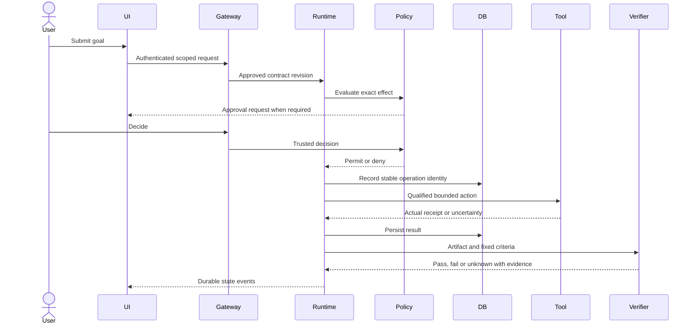

# Governed execution sequence

On restart reconcile operation identity and receipt before retry. On cancellation stop new dispatch and preserve completed effects. On scope change request a fresh approval. On disconnect replay observation rather than reissuing mutation.

Acceptance covers a real successful change, rejected approval, absent verifier receipt, crash before/after effect, stale fence and consumer restoration. All remain NOT RUN until executed on a qualified isolated environment.
